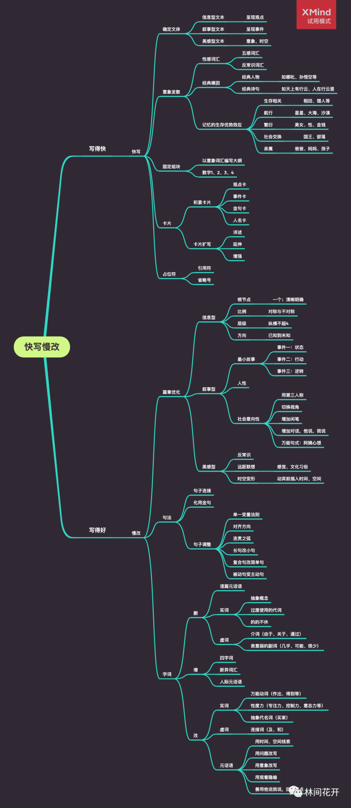

*写在前面：重刷写作课的内容，让我想到了要用类似《文章讲话》的方式输出系列文章。*

从去年年底报名开智的《快写慢改》写作训练营，复训两期，跟完三期课程，用了一年时间，受益良多。

由最初喜欢写作但怕写作的状态，到现在，享受写作，养成写作的习惯——每天写一到三张卡片，一周一篇千字文。

这门课，反常识在于——写作不是一件事，是两件事，所以就有了「快写」，再有「慢改」，两者有分工。就如建房子，先要有钢水泥。对写作而言，「快写」就是钢筋水泥，「快写」重效率，在于写得快。快写过程中，不要停顿，全凭感觉，一口气写完。记不清的用占位符， 其他的交给慢改。

慢改重质量，在于写得好。有了第一稿快写的素材，就可慢慢改。改什么，怎么改呢。传统的写作方法会教你从小改起，先改字词再改句子，这也是我过往的习惯。相反，《快写慢改》则建议从大到小改：先篇章后句子，最后字词，好处是，定好了结构，后面的只是小修小改，无需从头推倒重来。

写作课的知识密度大，复训了两期，知识点还未完全掌握，为了得以继续学习写作，申请了写作教练，庆幸通过。快写容易掌握，有意象，有卡片，很好启动。慢改就难太多，需要大周期时间内刻意练习。我常常快写能写得爽，慢改就改得痛苦，用斯坦诺维奇的「三重心智」来解释，就能发现其中的区别，快写是调用自主心智，是感性的结果；慢改则是算法心智和反省心智起作用，要耗费大量的脑力，是理性的结果，要慢慢想。从课上的知识点来看，慢改的内容明显比快写足足多一半。

写作是一场长跑，如果有人告诉你，他有速成的办法，在21天内帮你成为写作高手，那一定是骗人的。阳老师时常在群里直播写作，从写到发到公众号，快则一小时搞定两三千字文。他能写得快又好，离不开平时的积累和长年的写博客，在星球和群里的灌水，他写成卡片。在别人那里，写一篇文章是从一个字一个字开始，在他这，变成了用卡片写作，卡片是他写作的最小单位，需要写文章时，调取写过的卡片，拼接而成。

没有哪个课能像《快写慢改》课这样，让我一刷再刷，不记得刷了多少次，但每次刷课，都有新的理解，理解的过程就是创作的过程。在想，何不把学过的知识以文章的方式输出来，是为巩固知识，也为刻意练习写作，一举两得。就先从下面这张图开始吧。

