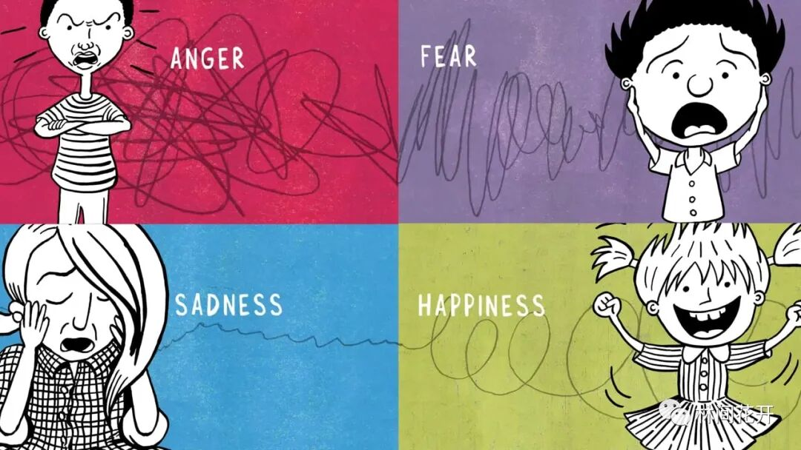

自认为不是一个合格的父母，生了两娃，仍然诚惶诚恐，一路磕磕绊绊，踩坑不少。在面对小孩哭闹时，容易情绪激动，过后又内疚不已。小宝出生那年，大宝正处在可怕的三岁阶段，各种不配合，上幼儿园困难，上厕所也跟着，天天粘在我身边，而我忙于照顾小宝，无暇关心她，严重影响到跟她的亲子关系。正当我一筹莫展时，阳老师开了「儿童发展大师课」，让我成为了300个家庭中的一个，从此，走上科学育儿的路。

一期儿童课留下的遗憾：《好学的大脑》没跟上，作业没写完，论文共读没参加，育儿实践不够，所以在二期的复训链接放出来后，报了名，并给自己下了几个指标：至少参加一期论文共读，作业必须写完，认真阅读《好学的大脑》。回顾这两个月的学习，二期开学定的目标，完成了80%。课程中讲到的依恋理论、心理理论、执行功能、元认知、工作记记等最重要的儿童发展理论，也变成一张张卡片输出，左手消化硬核知识，右手对孩子润滑细无声的实践，离成为一个好父母越来越近。

很庆幸，2021年参加了「儿童发展大师」课，以下是我的一些感悟和收获。

## 主动的学习者

孩子天生是主动的学习者，出生后迫不及待认识世界。《儿童心理学》告诉我，作为父母，要提供温暖，适时回应的环境，才能更好地激发小孩探索的好奇心。在语言学习方面，父母要跟小孩要有足够多的互动，也就是说，输入的数量很重要，先有数量再提高质量。相比限制性的语言，开放性的语言更激发小孩的探索。当小宝在用小剪刀剪纸时，我一改过往的“停下，不能用剪刀，太危险”这种限制的语言，而是饶有好奇地问：“你剪的形状是个圆形对吗？”，有了支持，她的兴趣更足，剪出各种形状，现在小宝玩剪刀玩得很溜。

在没上儿童课之前，我有不少违背科学育儿的做法。小宝在一岁多时，喜欢撕书，不断重复跟她说，不要撕书不要撕书，告诉她书是图书馆借来的。她根本不听，让我很恼火，最后以权威的方式制止了她。有一段时间，她都不愿意翻书。在《儿童心理学》中有一个概念「跨感官通道」，意在强调小孩要从多个方面去感知，除了听觉、嗅觉、味觉，还会用触觉。再看小孩撕书的行为，就很正常了，这是她认识书的一种方式，而我那时却强行破坏了她对书的感觉。

现在有了科学知识打底，看到小孩的不符合预期的行为，第一时间不是制止和训斥，而是先观察，接着倾听和换位思考。小宝爱玩水，她把纸巾撕成一条条，放在洗手盆里。爸爸看见了，直接说她不能玩水，一下把她弄哭。我赶紧抱起她问：“你是不是在水里玩一个游戏。”她破鼻而笑说：“我在给小鱼游泳（纸巾揉成一条条鱼）”。晚上睡前，小宝还提醒说，妈妈，下次，给我一个盆子，我把「小鱼」放在瓶子里，就不会弄湿衣服了。”

如果父母足够敏感，就懂得从孩子的行为中读到意义，而不是无端端给扣上「爱搞事」、「这小孩真难搞」的标签。小宝喜欢把椅子四脚朝天放下，挡住去路，我顺手挪动了一下，她就特别生气，说我动了她的火车头。她要开火车，现在车头、火车不能动了。看着她一脸气呼呼，我没有给激怒，心平气和地道歉后，帮她一起接上火车头，还多拿了几把椅子当车厢。那一天，她玩得特别开心。

## 依恋的安全圈

一期时，直接跳过《婴幼儿心理学》，想着小孩都过了2岁，再看意义不大。到了二期，受目标的驱动，重拾这本书，发现《婴幼儿心理学》不只是适合0-2岁婴儿，也非常适合2岁以上的儿童。抽样了依恋理论章节后，鼓起勇气报名了论文共读，汇报了以依恋理论为基础的安全圈项目，这个项目是一次依恋理论在商业上的实践，论文易读，借助「安全圈」圆环，懂得如何跟小孩建立安全的依恋关系。读完论文，也让我意识到，早期亲子依恋关系非常重要。

「安全圈」里的「双手」隐喻特别好，父母的双手是小孩的安全基地和安全港湾。一只手，代表着支持小孩的探索需求，让小孩能够自主探索。同时，要关注她，给予适当的帮助。另一手代表着，当小孩探索回来，要去欢迎她的回归，一个圆环才算顺利走完。如果父母的手不在圈上，小孩的需求就没有得到满足，代表着安全圈受到限制。在生活中，小孩经常有各种未知的状况，这些状况有些会让父母不舒服，就如「大白鲨」音乐一样，唤醒父母恐惧和焦虑，想要逃离和采用防御策略。这时就考验父母的耐心，有反思能力的父母，可能一开始会不舒服，但冷静后，就会从抱怨小孩闹事的麻烦中，转移到「我要怎么做」才能小孩感到舒服和安全。父母的同理心非常关键，所以安全圈干预的对象是父母而不是小孩，小孩的情绪脑发育太快，理智脑又没发育成熟，还不能处理情绪问题，需要借助父母这副脚手架。

大宝的安全依恋没做好，愧疚过一阵。她在0-3岁时，多次搬家，照顾者也常更换，不稳定的居住环境和不稳定的照顾者，导致她特别粘人。那时我上班，她抱住大腿久久不放开，哭闹一两个钟，不懂怎么处理这种分离，没有诚恳地告诉她妈妈是上班去了，下班就回来。到了上幼儿园，分离就更难，记得当时她一个学期都不爱上学，害怕小宝夺走了妈妈全部的爱。

学了安全圈后，我给大宝做了一次简单的示范，她活学活用，每当我给她弄得想要责骂她时，她可怜巴巴地说：“今天就让我走完一个圈圈（安全圈）好不“。在我对小宝闹事没耐心时，她适时制止住我：”让妹妹走完圈圈“。现在面对两个小孩的鸡飞狗跳，我淡定很多。

《婴幼儿心理学》还有一个反常识印象深刻。过去觉得小孩打闹危险，第一时间制止她不给继续玩。看了书才知道，小孩打闹，瞎玩都是有意义的，他们在探索和学习，所以建议父母多跟小孩玩打闹游戏。小宝有一段时间特别喜欢在床上蹦跳，还喜欢把两腿架上我头上，跟我玩「骑马马」，让我把她托在双手上，变成一架「飞机」假装飞起来，整个过程很兴奋。这些打闹游戏不仅「无害」，还促进了小孩的自我调节和与他人的合作，更为重要的是，放下手机，跟小孩玩一玩，有利于亲子关系的培养。

## 核心理论

同样是作者乌莎·戈斯瓦米编写，《儿童心理学》相对易读，理论精简，是餐前小吃。如想要彻底掌握科学育儿知识，还得吃《好学的大脑》这顿压轴大菜。开始接触时，难于下筷，直到二期，我才捧起了书，结合老师的视频讲解，再看书，输出卡片，越啃越有劲，闪烁在眼前的繁体字也变得性感，也更加理解《儿童心理学》前言中的那句「These are exciting times in child psychology」

抽样了第七章的心理理论、第八章的记忆以及第九章的执行功能，这三章是核心章节，也是儿童发展的三大理论，如能学透，并在育儿中实践，这门课就可以结业了。

儿童发展中两大绕不开的理论——心理理论、执行功能。如果说执行功能关乎的是一个人的智力，那么心理理论关乎的是「情商」，与社会认知有关，指的是理解他人意图。快写慢改课上阳老师用的是「社会意向性」这个词，有一到七阶，一流作家跟普通写作者的区别在于阶数更高，越厉害的作家，社会意向性的阶数越高。

心理理论发展好的小孩，社会情绪能力肯定也高。读绘本或生活中，多跟小孩讲心理理论相关的词汇，比如「我喜欢」、「我想」、「我认为」、「我相信」等，还有通过玩假装游戏，能够提高心理理论。另外，家里有兄弟姐妹的，心理理论往往也会好一些。

说完社会情绪，来说说跟智力有关的「执行功能」，执行功能对学业来说，至关重要。学习好的孩子一般执行功能也高一些，因为在学习中，涉及到抑制控制的能力，抑制无关的任务，把精力放在目标任务上，有专注力障碍的人就很难进行抑制控制。另外，学习需要在多个任务中切换，以及记住不同的知识点，这就要涉及到认知灵活性（在不同的思维中切换）和工作记忆。

什么是执行功能，指的是有效控制自己的想法、意识和行为的能力，自我觉知、监控、调节的过程，涉及到三个模块：工作记忆、认知灵活性、抑制控制。书中提到可以通完两类任务来测量，一类延迟满足任务，经典的是棉花糖实验；一类冲突任务，主要是指白天黑夜这类游戏。冲突任务的实验其实也是测量了抑制控制能力，在冲突任务中，需要对着即使是习惯性的答案，也要抑制住，说出一个错误的答案。0-3岁时，多玩「国王说」、「白天黑夜」、「木头人」等游戏，可以提升执行功能。

执行功能还有冷热之分，偏认知的学习，就是冷执行功能；涉及到情绪化、情感事件，就是热执行功能。冷热两种所展示出的能力也不同，比如在情绪化的情景下，抑制能力相对较弱，很难做出好的判断和决策，所以也不难理解，人在炒股、赌博时，往往是不理智的。

## 激发潜能

《好学的大脑》最后一章，了解了儿童发展的脉络，离不开两位著名的心理学家，一位是皮亚杰，一位是维果茨基。

不同于皮亚杰研究「一个人是如何通过行动来塑造大脑的」，维果茨基侧重于研究「个体是如何与他人大脑来塑造自己的大脑」。他英年早逝，来不及为他的理论做实验验证，但他的见解对教育心理学领域都有极大的影响。

他认为社会和文化对儿童的发展有非常关键的影响，他提出了内部语言理论，认为语言是塑造认知发展的最佳工具，引导行动和思维。儿童也如成人一样，有了语言，能够像成人一样「思考」，组织内在心理活动和表达想法。

维果茨基最重要的理论是「最近发展区」，他提到独立解决问题的能力跟借助他人来解决问题的能力的差距，这就是「最近发展区」。举个例子，一个8岁的儿童在没有他的协助下，也许能解决8岁儿童能力水平的数学题，但如果有老师指导，或许能解决10岁儿童能力水平的数学题，也就是说，老师在其中发挥着重要的作用，「教」比「不教」更能促进小孩的潜力，有了「教」，小孩就能跳起来够得着。所以父母和老师不要去匹配小孩的能力，而是要匹配小孩的最近发展区，这样才能激发儿童的潜能，有效学习。

小孩的学习离不开游戏，平时应该多引导小孩在游戏中学习。《儿童心理学》第四章提到的假装游戏——消防车游戏，儿童能够遵守游戏中的规则，从而提升执行功能和认知灵活性，他们还会在游戏中学习知识的表征，比如把玩具当电话用。最重要的是，在游戏中，儿童始终是在「最近发展区」内活动的，他们能够在游戏中习得的知识转化个人经验，丰富自己的数据库。

## 小结

很认同王贞琳老师说的，父母要跟开车一样，需持证上岗。如果不是参加了儿童课，我仍然对小孩的发育规律一无所知，更不知道0-3岁的发育至关重要。现在小孩出现哭闹及情绪问题时，不会想去逃离，而是把它当成是一次学习做好父母的机会。正如《无条件养育》译者小巫所说的「这很难，但仍值得我们全力以赴」。

在我的头脑中，不存在完美的父母，父母做到足够好就好了。好父母最好的诠释，是来自于「安全圈」视频，Be Bigger, Stronger ,Wiser, Kinder，这句是安全圈的口号，也是我成为好父母的角色典范。