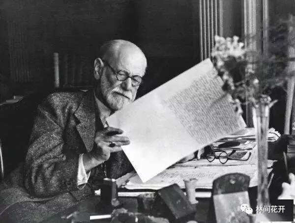

坊间有太多弗洛伊德的说法，有赞美就有质疑。在没有读他的作品之前，我对他的认识，仅仅是道听途说。

一直好奇，一个这么有争议的心理学家，何以过了一个世纪之久，世间仍然有他的传说。

过年期间，翻开了厄内斯特特.琼斯写的传记「弗洛伊德传」，得以窥见真实的弗洛伊德，重新认识了弗洛伊德，。

这本传记比较特别，作者是早期的心理分析师，是国际精神分析核心成员，见证了弗洛伊德生前的历史，历近40年。还是弗洛伊德最亲近的人，在他死后，得于从他的遗孀中获得了生前的大量信件。

## 1

人人都爱听故事，有些人喜欢讲故事给别人听，有些人喜欢听别人讲故事。

作者琼斯是如何讲述一代心理学伟人弗洛伊德的故事？书的目录，按时间线，分成三大部分，第一部分是出生到44岁，性格形成和重大发现阶段；第二部分是成熟期，45-63岁，他的创作高峰期；第三部分，弗洛伊德晚年阶段64-83岁。这样时间尺度跨度有点大，以12年的时间周期，重新划分弗洛伊德的人生叙事，看他是如何导演自己的一生。

### 0-12岁，叙事早期。

1856年5月6日，弗洛伊德出生于摩拉维亚（捷克）弗莱堡的锁匠街，为了纪念他，在他死后，这条街更名为弗洛伊德大街。他们一家是犹太人。父亲是雅各布，以羊毛交易为主的商人，在他40岁那年，迎娶了第二任妻子（即弗洛伊德的母亲）阿玛莉亚.纳坦森。两人都很长命，弗洛伊德的父亲在81岁逝世，母亲在95岁逝世，父母的长命，意味着弗洛伊德也可能长命。他即使患有口腔癌症，还是活到了83岁，在去世前一天，还在工作。当他知道肉身失去了心灵时，他理性地让医生打了三剂吗啡，结束生命。

琼斯表示弗洛伊德对7岁前的记忆较模糊，早期的事件大多是从家人口中得知，所以不如看看弗洛伊德的原生家庭。

小时候，弗洛伊德受母亲的影响，树立了「成为一名英雄」的人物原型，他有很强的成就动机，极度自信，渴望声望。母亲生性活泼，在8个小孩中，最爱长子弗洛伊德，称他为「我宝贵的西基」，并视他为骄傲，确认弗洛伊德长大后必定会成为伟人。弗洛伊德曾写：

> 一个被母亲完全喜欢的人终其一生都会有一种作为胜利者的感觉，而这一成功的信心通常会带来真正的成功。

弗洛伊德与父亲的关系不如跟母亲那般亲密，早期他崇拜过父亲，但在父亲讲述他被非犹太人打落帽子的一次事件后，没有反抗，父亲高大的形象从此跌落神坛，但不至于市面上书籍写的，弗洛伊德与父亲有「仇父」情结。

他父亲生性温和，在家庭中受欢迎。弗洛伊德继承了父亲的心智和幽默感，始终对未来充满希望，还从父亲那里学到独立思考的能力。

从小，他家人就极度重视他的阅读。5岁那年，他父亲给了他和妹妹一本书「穿越波斯的故事」，父亲建议弗洛伊德和他妹妹可以撕掉书的彩页来玩，这种怪异的教育方式，激发了弗洛伊德读书的热情。

8岁弗洛伊德就读莎士比亚的作品，他不满足于教科书精简的材料，偏爱各个学科领域中卷帙浩繁的专著。

弗洛伊德是唯一一个拥有房间的孩子，他在这房间里阅读、学习、写作等，甚至在房间吃晚饭，节省时间来阅读。在其他人用蜡烛时，只有他能用一盏油灯。在这个房间，生活了10多年，度过了他的小学、中学、大学等，房间唯一变化的就是书的数量。

## 2

****12岁到60岁，****叙事中期，这时弗洛伊德已经积累了一定的人生素材，这一时期的主题是寻找角色榜样和自我成长。

17岁，考上了维也纳大学。尽管父亲让他自主选择，他选了医学专业，但他一直不喜欢这个专业，那时，他对生理学和哲学更感兴趣。在校期间，最喜欢上布吕克教授的生理学，也经常上哲学课。布吕克有专业的科学素养，有科学家的典范。或许那个时候，弗洛伊德把布吕克当成了他最重要的角色榜样。

从弗洛伊德读的专业和他后来所从事的职业来看，他跟常人一样，走了些弯路。他对人类活动背后的意志、动机、目标更感兴趣，而且坚持认为知识是成就、成功、权力的秘密。

****24-36岁，****探索职业方向，确定志向。在这个阶段，他各种发展不顺，事业处于探索中，经济窘迫，好在他在26岁（1861年）遇到了人生伴侣玛尔塔，同样是犹太人，小他五岁，爱情让他缓解了不得志带来的压力。

他俩交往非常迅速，认识两个月后，火速订婚，订婚日是6月17日，有一段时间，每个月的17号都会庆祝。订婚四年三个月中，异地三年。在弗洛伊德30年那年，他们结婚。

未婚妻长得如何，她的照片很少，书中只有一张，她跟弗洛伊德站在一起的合影，很漂亮，但弗洛伊德对她的美很谦虚：

> 你的面容和身体传递出你的存在本身就是一种魔力，从你可见的外表之中，我可以看出你是多么甜美，慷慨，恰到好处。我自己总是对形式美比较迟钝。

他在事业上，努力争取，在爱情上，也如此。在他看来，爱情应该是完美无瑕的，结婚前这段感情炽热又怀疑的感情，让弗洛伊德始终于怀疑、恐惧、不满、猜忌、嫉妒中，弗洛伊德受本能驱动力的影响比大多数人强烈，这或许是伟大天才该有的本质特征吧。玛尔塔当时身边主要有两位仰慕者，一位是音乐家，一位是画家，这两人让弗洛伊德醋意十足，说他当时是一个狂热的爱情学徒也不为过。

玛尔塔是他的初恋，也是跟他一生走过53年的妻子。很难想象，像心理咨询师这样的职业，接触的大多是女性患者，不受诱惑，还能坚持一夫一妻制。他对这段感情保护得也极好，很少在他的书中提及，如果不是作者跟他们的关系要好，难于看到他跟他妻子的内容。

一生与妻子900多封信件，足以看出，两人感情的厚度。在订婚后，一天写两三封，一封最短4页，最长12页，他对妻子有炽热的爱。结婚后他们结束了异地恋生活在一起后，只要弗洛伊德出门，他都会跟她写明信片、信件或电报联系。

此时的弗洛伊德发展不太顺利，但他遇到了人生中的贵人，有最早资助他的布罗伊尔，从1882年到1894年，一直在经济上帮助他，他还把社会资本转化了文化资本，两人合著论文。受布罗伊尔的影响，弗洛伊德还认识了人生中最亲密的朋友——弗里斯，两人生活境况相同，有相同的科学见解，可以说弗里斯是非常好的听众，激发了弗洛伊德的灵感和创作，很多理论在这一时间出现，书中用了「弗里斯时期」一个章节介绍他俩认识的过程，足见弗里斯的重要性。

还有一个贵人值得一提——沙尔可，1885年-1886年，弗洛伊德师从他学习，还翻译了他写的著作，缓解了经济压力。在这个时期，弗洛伊德出了第一个作品「失语症」。

## 3

****36岁-48岁：****叙事中期，这是他创作的高峰，他的非凡能力显露无遗。

39岁，弗洛伊德从布罗伊尔的病人安娜.O.小姐中，发现了歇斯底里的移情现象，后来与布罗伊尔第一次把病人研究成果——对歇斯底里症的研究论文发到《神经学专刊上》，这一次的成果有历史性的意义，两年后，他们联合署名的书《歇斯底里症研究》跟着问世，这就是精神分析的起点。

歌德说：“热爱真理是天才的第一件事，也是最后一件事。”41岁，弗洛伊德做了一件大胆又冒险的事，他对自己的潜意识进行精神分析，这是一件在智力和道德层面都需要非常大的勇气。他不惜一切代价，为之放弃安逸、成功、幸福。

「认识你自己」的确是一件非常难的事，在人类漫长的历史中，不乏有哲学家、作家的身影，从梭伦到蒙田，从尤文纳尔到叔本化屡次尝试，但最终都屈服在无意识漆黑之夜中，探索灵魂注定是一件难以完成的事。

走上自我分析之路，一旦开头，就没有回头路。有三到四年的时间，弗洛伊德忍受着神经症的折磨和所带来的痛苦，但经历了辛苦和苦难之后，他不仅获得了真理，还得到了一个全新的自己，正如他所说：

> 当我无法感同身受地理解别人时，我总觉得十分奇怪。

43岁，父亲去世这一事件，唤醒了他早年情感，在进行了两年自我分析后，激发了他对梦的深度研究，他把这一研究成果写了「梦的解析」，完成了他对自我探索的英雄壮举， 这本书是他的成名作。

有几年，没有任何销量，也没有得到回音，出版10年后才得到认可，收到再版，一生中出版了8次，最后一次是1929年，每次修订都没有太大什么变化，只是插图或者象征性对主题补充，可见当时的弗洛伊德的观点是多超前。

你会发现，弗洛伊德的理论偏自传式，这跟他从自己的童年经验和对自己神经症分析有关，他是直觉非常强的人，当神经症抵达心灵深处时，他没有逃避，反而为自己所用，进行研究，包括他提出的人格结构，也是基于自己的经历和心理咨询中病人的案例而成。在他创作的过程中，可以感知到弗洛伊德的努力，也能感知到他时而困惑，时而压抑，但他直面困难的能力让他成为弗洛伊德。

有高峰就有低谷。一代伟人，弗洛伊德经历无数次至暗时刻。

他身边的核心朋友，进进出来，最为出名的是阿德勒和荣格在这个时期出现，也在这个时期与他决裂。如果说阿德勒的出走，只是让他伤心了一回，那荣格的「背叛」，对他打击甚大。之后遭遇女儿苏菲和外孙的去世，把他彻底打入了深谷中。遭遇了两个家人的去世，一向自信又坚强的弗洛伊德，声称这是「一场永远无法自愈的深度自恋的痛苦」，这也标志他的情感生活的终结。

## 4

****60-83岁，叙事晚期。****处于战争阶段，不幸、焦虑、和战争是这一时期的关键词。

战争激发了他对军事的热情，他加入了战局的讨论，他的两个儿子也都在意大利前线作战。

哪怕他在学术上获得了巨大的声誉，在战争这个大背景下，60多岁的弗洛伊德，过得并不好。来自于生活的困难和焦虑、灾难性事件，那时的弗洛伊德只能听天由命。

有意思的是，在他64岁那年，被誉为德语散文大师， 荣获了歌德文学奖。他的散文是奥地利风格，灵活，他是一位娴熟的作家，文笔流畅，有着优雅和简洁的表达，但他并不是一个谨慎的作家。

67岁时，他经历人生中最为关键的一年——他得了癌症。在2月份的一封信中，他提及了：

> 两个月前我发现我的下巴和上颚右侧出现了白斑，20日我刚去把它们切除了。我还没开始工作，不能吞咽。

对这场病，弗洛伊德并不惧怕，他自己的生命不太关心，不关心生或死，他更关心的是自己的创作，当他的朋友们善意地隐瞒他得癌症的事实时，他瞬间愤怒，接受不了别人认为他不能自主思考，他接受不了自尊心受到侮辱。

从发病到生命结束，他拒绝其他人的护理，只需要安娜陪在身边。这场折磨了他16年的病，历经了33次手术。

晚年的弗洛伊德，受战争和癌症的影响，过得并不好，在去世前的一年，他还被迫离开家乡，跑去伦敦。直到肉身失去他的心灵，没有了价值，只有痛苦时，他选择了结束生命。

纵观弗洛伊德的一生，他是孤独的，虽然曾与布罗伊尔、弗里斯、阿德勒、荣格等人迸发出火花，也激励了他们的探索，但最终还是给他们抛弃，不得不一人孤身追寻答案，他说他的世界是「一座充满苦痛的孤岛——漂浮在一片冷漠疏离的海上」。