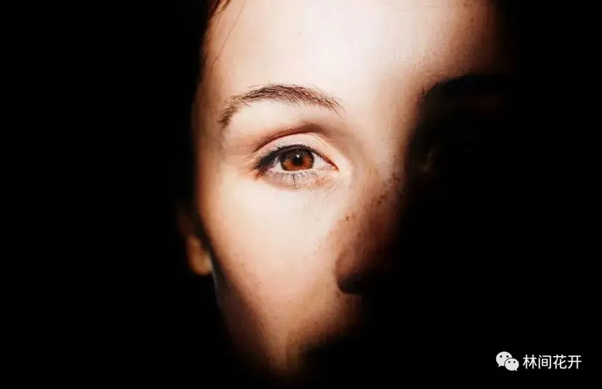

**写在前面：行为分析四期课程结束，感觉还停留在开学之初，回味无穷。带着情境记忆，写下这份学习小结，回顾这一期的课程。**

阳光明媚的四月，坐在桌前，听完阳老师讲完行为分析四期课最后一节，意犹未尽。尽管当下战争不停，疫情不灭，裁员不断。但在阳老师这盏探照灯之下，得以窥见幽深的人性。拨云见日后，仍对这世界抱以美丽的期许。

## ****1****

何其有幸，能够跟着阳老师从一期到四期，整整花了9个月时间学习，欲罢不能，可见这门课的魅力。一路学过来，见证了阳老师是如何优雅地提出一套人性系统论。如果要向朋友推荐这门课时，我该怎么说呢？

我应该会说，这是一门阳老师二十多年的心理学集大成之作。他站在伟大的心理学家、认知科学家的肩膀上，提出的一门解决实际问题的课程。有个人发展停滞问题、情绪障碍问题、也有婚姻和谐问题。每一个问题都很大，如果再把这些问题组合在一起，就更复杂了，但生活中就是有这么多复杂的问题。相信每个人或多或少都会碰到这些问题，表面是要解决，实际是要探寻人生的意义。如何解决，请上行为分析课。

解决人生遇到的各种问题，要回到原点，重新认识你自己。你是谁，你有什么样的行为模式，你的简化与冲突是什么，都可用行为分析课中的人性系统论来回答。人性系统论指的是由人们大脑与人、情境、情绪相关概念组成的系统。

按照颗粒度分，人性系统可分为三个版本：极简版、大众版、专业版。从大脑算力上看，可以解释三种以上的行为；大众版可以解释数万种以上的行为；专业版可以解释数亿种行为。

在极简版中，你只需要记住人性系统的三个变量：个人、情境、情绪。语义表达是，你在什么样的情境下，会感到如何。比如，内向的人在社交情境中，会感到不舒服，想要逃离现场。

在极简版的基础上，大众版叠加了16组个人概念。个人概念是认识世界的最小单位，指的是个人在其生活中经由对环境中人、事、物的认识、期望、评价、思维所形成的观念，比如，你认识了一个活泼外向的朋友，下次你介绍他时，会说他是一个外向的人，「外向」就是你对他形成的个人概念。

大众版足够解决上万种行为，对普通人来说，已足够用。专业版面向的是专业工作者，如咨询师。有志于成为人生咨询师的，可以在专业版上进修。

人性系统中的形成的个人概念，受大脑最小能耗和自我保护机制的影响，产生三重简化和三重冲突。简化好比是导航系统，能快速帮帮你定位线路，减轻大脑的认知负荷。

简化有三类：整体性简化，如对他人形成刻板印象，他是好人；他是坏人。按简化的程度分为过度简化、中度简化、轻度简化三个层级；第二类是测量尺度的简化，用二元对立代替多元，你会把人简单粗暴看成好人和坏人，聪明和笨蛋，这反映了大脑爱偷懒的特点，能不思考就不思考，能少思考就少思考；第三类是个人经验的简化，你知道的你才会相信，你见过的你才会相信，不管我怎么劝说，我妈就是相信神明是会保护我们的。

受自我保护机制的影响，避免人性系统的崩溃，还会产生三重冲突，三重冲突按部分与整体，分为部分与部分的冲突、部分与整体的冲突、整体与整体的冲突。

冲突是动力系统，一个人最迷人的地方在于冲突，解决人性问题，往往从冲突入手，找到关键所在，促进人生发展。如何解决冲突？高手的做法是，把冲突变成生产力，输出作品。弗洛伊德的神经质很高，直接成为研究自己的一个突破口，把自我探索变成作品——「梦的解析」。

## 2

自古有「听天由命」，这是一种消极的态度，更好的做法是，用学到的人性系统，给自己科学算命。知人知己，成人成己。

借助人性系统，对自己或他人进行预判，如何预判？行为分析课程提出两种行为预判新框架：简单模型和复杂模型。

简单模型用以预判单一目标，分析人格特质、认知能力、动机偏好或人生叙事这类静态的行为目标。从已知的行为线索中，预判一个人是外向还是内向；聪明还是笨蛋；自主还是顺从等。

预判单一行为五大流程：

1、确定预判目标是要预判什么？是看一个人靠不靠谱，内不内向，还是聪明不聪明还是别的，圈定预判目标。

2、 被预判者被预判者是否做了相关的行为，这个行为信息能否给你觉察到，并用来预判他的行为。

3、行为线索和三角测量常见的行为线索有语言、非语言、情境、其他等，线索分强线索和弱线索，强线索更容易判断一个人的行为。提高预判的准确性，可以采用三种数据，也就是三角测量，类似于信分中的交叉验证。

4、预判者不同的预判者，预判的准确率也会不同，比如阳老师，功力深，能一眼找出一个人的问题所在，预判的效率和准确率会更高。

5、被预判者-预判者的关系两者的关系会存在偏差，我是外向的人，在看他人时，也会容易把他人看成是外向的人。还会出现家庭效应， 家里两娃，我会更偏向小宝，对大宝有要求；而队友偏向大宝，总认为我对小宝太好，对大宝不好。当两个娃发生冲突时，即使有时错的是小宝，我安慰的是小宝，指责大宝，经常会出现这样的行为反应。

如果涉及到的是有行为链的多个目标，就要用复杂模型，行为预判中最重要的模型——责任与功劳模型。

如何理解责任与功劳模型，可以从人性系统的最小情境行动周期入手。个人是镶嵌在时空情境之中，他人也是情境。在特定的情境中，个人概念会给激活、唤醒。

在一个人做出行为倾向之前，情绪先发生。40毫秒就能产生情绪反应。情绪反应就像足球的守门员一样，结合个人概念（人格特质、认知能力、动机偏好、人生叙事）进行调节、拦截。在面对一样的事情，每个人的反应是不同的，在面对领导的批评，有的人会顶回去，愤怒离去；有的人则是低头沉默；也有的人会以幽默回击，一笑而过。

个人概念在情境给激活后，情绪会产生三种反应，一种是消极的，引发的是行动瘫痪或是放弃；一种是中性的，引发的行为是保持原状；最后一种是积极的情绪反应，引发的是，执行行动。在做出行动倾向后，会产生两种反馈：正反馈和负反馈，这两种反馈会形成情境记忆，变成习惯、技能或是自传记体，不断地滚动和循环，在大脑中留存下来。正如课程结局里说的：

> 你在与情境的互动中，留下了一些什么？那是风雷水火土，那是喜怒哀乐，那是知识与记忆。时过境迁，这些个人概念是如何促进和阻碍你的人生发展？

3

知命之后，如何改命，有什么高效的行为改变方法？这是行为分析课中的第二大精华内容，是行为分析课最难的部分，涉及到要给人生找定位，制定行为改变方案。

基于当前行为问题制定目标，难度不大。找出目前最阻碍，最让你不舒服的问题后，再用6大改变技术去设计方案，一一击破。难的是如何借用阳老师三大秘密武器：人性系统论+人生资本论+人生周期论，整体上制定人生目标。

人生命题，无非回答「我是谁」、「我来自哪」、「我去往何方」，这是哲学问题，也是人性问题，行为改方案同样涉及到「我来自哪」、「我是谁」、「我去往何方」，这三个方面包含了过去、现在、未来，如何回答，最重要的是给自己创设一个意象原型。

4岁开始，你已经有意识借助具象的东西（意象），认识经历过的事情，初步建立事物的意象原型。这个时候，大部分出现的是家庭和学校，有爸爸妈妈、老师、小朋友，还有来自书中的人物如白雪公主、女巫等意象，之后你会把这些意象拟人化后的形象，就变成了你的意象原型，长大以后，就会去想，我要变成妈妈那样的人；我不想变成爸爸那样的人。

你是你自己一生的作者，在人生叙事前期，收集以意象原型相关的写作材料，为叙事中后期做准备，撰写人生故事。

意象原型对改命为何如此重要？借用心理学家埃里克森的同一性理论，意象原型能够统领整合多个自我，把过去的我、现在的我、未来的我统领成一个自我同一性，回答我是谁。

阳老师从大脑的角度，解释了意象原型的重要性：

> 人是通过叙事、形象思考的，而不是通过理性、逻辑思考的。叙事、形象类思考挤占大脑脑力最小。

如何找到意象原型？可以从你的10个自传记记忆中去找，你的高峰事件、低谷事件、儿童事件等，找出你喜欢的重要他或是不喜欢的人，这些人往往是来自你的父母、领导、同事、朋友、老师等，最为关键的是，第一个影响你的老板；第一个影响你的老师；第一个书中影响你的人物；第一个偶像等等。

需要注意的是，现实生活中的比书本中的意象原型更重要；能接触到的比不能接触到的更重要。

意象原型由一组词汇组成，包括主体词和限定词。从角色榜样中找到朦朦胧胧的主体词，再从人性系统中找到限定词。

你设定的意象原型有没有想当然，衡量的标准是，是不是基于人性系统去考虑。心理学家斯金纳在22岁时，有志于成为一名小说家，明显不符合他的人性系统，在他的认知能力中，感商不高，反而是智商和理商很高。幸好，他没在小说家这个意象原型逗留太久，之后，他找到了人性系统更匹配的「工程师」意象原型，度过了他简单又辉煌的一生。

阳老师说，好的行改变方案，要既可远观，又能细看。远观指的是，找到的意象原型能管上12年，只管3个月、半年的，就不是好的意象原型。细看指的是，围绕意象原型，制定目标的执行计划，1个月、2个月、3个月到6个月不等。作品是实，意象原型是虚，虚实结合，才能走得更远。

在远观和细看的前提下，再结合人性系统，借助行为改变的6大技术、36个妙招，从认知、动机、叙事、情境上，借力打力，提升行动力，促进人生发展，达成改命目标。

## 小结

每个人都是独一无二的。何以更好成为自己，需借助行为分析这盏探照灯，顺着人性来。哪怕前面的路，荆棘丛生，也能在光束中，坚定前行，一步一个脚印。找到人生定位，整合自我同一性，发展出独特的人格魅力。到了老年阶段，再来回顾这一生，能坦然面对和接受过去，而不是抱着遗憾和绝望离去。

changelog

ref 开智行为分析课四期&人性大师课

day20220422