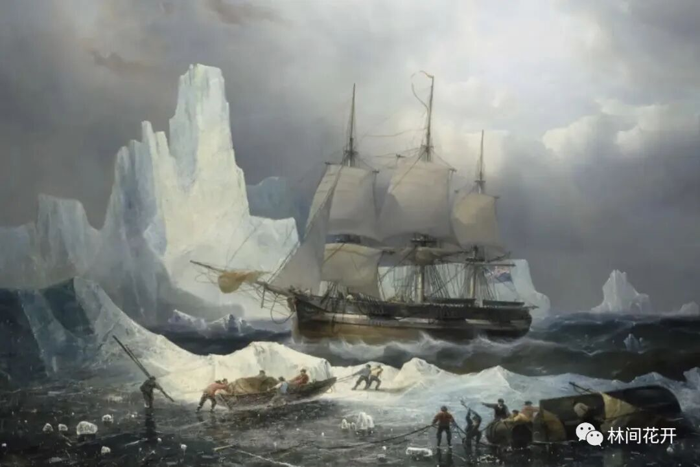

*（来自网络）*

提起富兰克林，也许你会说他是一名政治家、作家、发明家、议长、慈善家、印刷工人、电学家、和平缔造者、宾州总统、美国的领导者......清单能列很长很长。

如果说以上这些都是读者眼中的富兰克林，那么富兰克林眼中的自己是谁？富兰克林的富兰克林是谁？

## 身份认同

最近重刷富兰克林的自传，留意到他生前写的两份遗嘱，一份写于1750年（中年）：

> 我，费城的本杰明.富兰克林，印刷人.....

一份写于1788年（晚年）：

> 我，费城的本杰明.富兰克林，印刷人，前美利坚合众国驻法全权公使....

两份遗嘱，相隔38年，内容不同，却指向同一个点——印刷人，这是富兰克林鉴定的一个身份。

自传的正传中，富兰克林花了大量的笔墨描述他当印刷人的来龙去脉。讲了他原本想航海，父亲不同意，转而让他跟哥哥学印刷。富兰克林从小爱阅读，同意了他父亲的建议。在他哥哥的印刷铺当学徒，签下9年的师徒契约，成了他哥哥的得力助手。在以富兰克林的名义出版报纸事情上，两人产生争议，闹翻，决裂。

富兰克林一气之下离开了哥哥，从波士顿出走到纽约，再到费城，伦敦。打工或创业，自始至终，都没离开印刷业。

印刷人的身份在书中体现得淋漓尽致，成了富兰克林的头号身份。为什么富兰克林看重印刷人的身份，有两点，第一点他在「穷查理年鉴」提到：

> 品德和手艺是少年的最好命运。

他把印刷人看成是一门手艺，这是他的立身之本。最初写自传想告诉他的子孙们，他这样一个出身穷困，早年辍学的人，靠着一门精通的手艺也能过上好日子。

第二点，用心理学家埃里克森的「同一性理论」来说，富兰克林用印刷人串起了过去的我、现在的我、未来的我，将他的人生整合成了同一个自我。

不论时空如何变，富兰克林还是富兰克林，精通印刷手艺的富兰克林。从他的墓志铭也能出这一点：“富兰克林——印刷工人。”印刷人的身份贯穿了他的一生。

在开智的行为分析课上，阳老师提到了另一个描述身份的词汇——意象原型。他指出，意象原型由两部分构成，限定词+名词，以此来看富兰克林的意象原型。「印刷人」是名词，限定词是什么呢？富兰克林是一个什么样的印刷人？自传的正传中，富兰克林是一名喜欢写作的印刷人。在他哥哥的印刷铺当学徒时，自学写作，匿名投稿，他模仿「旁观者」的写作方法为世人津津乐道。

## 身份转变

富兰克林不是总统，却活成了跟美国总统一样的地位。他的头像印在了美国的百元大钞上。在读自传时，很好奇，富兰克林是如何从一名出身卑微，热爱写作的印刷人，一跃成为一名国父般的人物？

自传的续传2中的两封信起到关键作用。这两封信分别是富兰克林的两个朋友所写，他把两封信放在续传2的开头，足见其重要程度。  两封信长短不一，观点明确，两人都提到了富兰克林的个人故事，与美国这个民族的关联。还不约而同提到了青年话题。

或许在收到阿贝尔.詹姆斯的来信，他就意识到他要做出身份转变，他把朋友写的第一封信寄给另一个朋友本杰明.沃恩，在获得两人一致的观点下，他转而去思考：他在美国历史上要扮演一个什么样的角色？成了转变身份的一个关键。   第一封信中，费城富商阿贝尔.詹姆斯在信中写着：

> 这类自传作品对青年人思想上的影响是巨大的，在我看来，在我们公众领袖的日记中，您的这种感染力尤其明显。它潜移默化，引领着一代又一代的青年人决心成为一个像您一样善良和优秀的人......那么这样的的一部作品对青年们将是多么有益呀.....

本杰明.沃恩第二封信写得更详细，先是把个人跟民族捆绑在一起：

> ......您的毕生经历，也是与一个蒸蒸日上的民族的一切风土人性和现实情况分不开的。

> 从这个角度看来，我认为您自传的重要性，对于一个真正研究风土人情和人类社会的学者来说，不亚于凯撒大帝和古罗马最伟大的历史学家塔西佗的著作。

第二封大幅提到了富兰克林的自传带给美国青年的影响：

> ......学校教育和其他教育制度常常按照不正确的原则进行教学，教的是一套指向着错误目标的笨拙方法，但是你的方法既简单，目标又正确。

> 正当家长们和年轻人因找不到其他恰当的方法而感到彷徨失措，不知道对未来一生中合理的道路方向当如何进行估计和准备时，您的重要发现是许多人的力量所不及的。

> ......因此，先生应把当作的事指示给父亲们和儿子们看，帮助一切智者成为像您自己一样的人，也帮助其他人成为明智之士....

采纳了两位朋友的建议，中断多年的自传，富兰克林继续写下去。

如果说写自传的初衷是为了后代子孙而写，让他们知道他们的父辈如何从草根逆袭成为美国人人爱戴的人物。在续写自传中，富兰克林意图明确，为公众而写，为美国广大的年轻人而写，读者群从家庭内部转向社会外部。

在读「传记文学理论」这本书中提到，富兰克林之所以能成为富兰克林，离不开他创建的四大工程：

> 第一个：读、写、思、辩、行的智力培养工程；第二个：「我的朋友」组成的人际关系工程；第三个：以十三点品德筑成的道德完美工程；第四个：习惯性做好事的「公益事业」工程。

草根出身的富兰克林，自学成才，一步步从起步不高的印刷工人，靠着根基牢固的四大工程，从个人身份完美过渡到民族身份，成为美国广大青年的偶像。

用阳老师在「人生资本」课中的七大资本来说，智力培养工程是文化资本；人际关系工程是社会资本；道德工程就是他的心理资本；公益事业工程更像是政治资本。

他的四大资本，助力他的身份转变，一跃成为美国的国父，影响着千千万万的青年学子。

## 品德养成

在实中身份的转变，最关键的是培养13点品德，富兰克林设计了一套行为改变方案：

> 我想出了一个达到完美品德的大胆而费力的计划。我希望我一生中，在任何时候都要做到不犯任何错误，我要克服所有缺点，不管它们是由天生的爱好，或是习惯亦或是交友不善所引起的。

这套方案包含13个品德：节制、缄默、有序、决心、勤奋、真诚、正义、中庸、整洁、冷静、节欲、谦逊。  制定了以行为为目标的方案后，他从认知、动机、叙事、情境上加以放大。

认知上，避免制定的品德分类产生歧义，每个品德的定义作了说明，框定了使用范围。品德「节制」的的定义，指的是食不过饱，酒不过量。

富兰克林制作了品德表格，出差或做别的事情，小本本都随身带。为了促进行为改变，他在本子上写了激励人心的题句和箴言。叙事上，富兰克林不仅想成为子孙后代的榜样，还要成为美国年青一代的榜样。

如何监督行为改变？富兰克林有妙招。画出表格，用一周观察一个品德，最小行动落到每一天。当天检查，如当天没做到，就画上一个黑点。

13个品德，执行13周，一年循环4次。他还提到，13个品德，不要全面出击，而是要各个击破。

使用拔草来类比，一个人要把一座花园的野草都拔掉，不能想着一次全拔完，而是一次拔一点，拔完一波后，再拔另一波。

对应到他的13个品德，他先从「节制」观察起，养成了节制的习惯后，再下一个品德。

当他执行不下去想放弃时，他举了邻居家铁匠的例子。一个顾客想把他的斧头磨得像斧口那样亮，但摇轮子很吃力，顾客只好放弃说：“我想我最喜欢一把有斑点的斧头。”以此断定「一把有斑点的斧头是最好的了」。

在道德和恶习方面养成好习惯，打破坏习惯，总是很艰难的，富兰克林以「小故事讲出大道理」的方式警醒自己，制定计划后，要坚持执行。这种小事被赋予教育意义的例子，在自传中，随处可见，体现了他一贯的生活哲学观。包括他的13点品德，都变成了一个个寓言故事。

富兰克林还使用了心理保险（应对行为改变的目标万一失败了怎么办的策略），在执行中发现「有序」的习惯很难矫正， 他自我宽慰：

> 总体而言，我原先雄心勃勃地想要达到的完善境界，虽然我从来没有达到而且相关很远，但我靠着这方面的努力，却要比我尝试前要好得多，快乐得多了。

用了临摹来类比，就像临摹帖本的人，他们目标是想要获得完美的书法，虽然他们永远也没法达到他们想要的卓越的书法，但他们在练习的过程中，书法得到了改善，写的字也比之前整洁易读，这就很不错了。

从行为改变的成果来看，富兰克林执行到位，在13点品德的加持下，一跃成为美国的全民偶像。他把他的成功归归于道德完美工程：

> 他把他长期的健康和他那迄今还强健结实的体格归功于节制。

> 他早年境遇安适和财产的获得和一切使他成为一个有用公民和使他在学术界得到一些声誉的知识，这一切当归功于勤勉和俭朴。

> 国家对他的信任和给他光荣的职位，归功于诚恳和公正。

> 他的和气和他谈话时的愉快爽直归功于全部品德的影响，即使他不能达到尽善尽美的境地，由于他谈话时的愉快爽直，即使在晚年他还颇受人们的欢迎，甚至年轻的友人们也喜欢与他交往。

## 小结

如何从富兰克林身上得到启发？借用美国第三任总统托马斯.杰斐逊的一段话：

> 富兰克林生下来时比我们中最穷的人还要穷，但他具有不以自己穷困为耻的勇气，并凭借这勇气成为他生活的时代和国家中最伟大和最出色的人。

经典就是经典，哪怕过去百年，「富兰克林自传」一书值得一翻再翻。