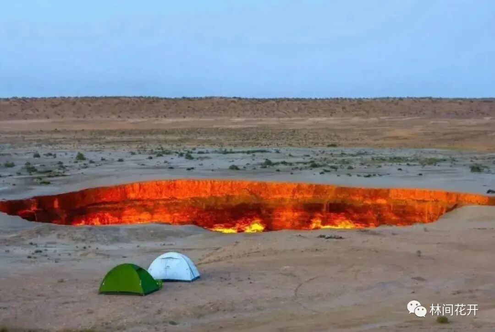
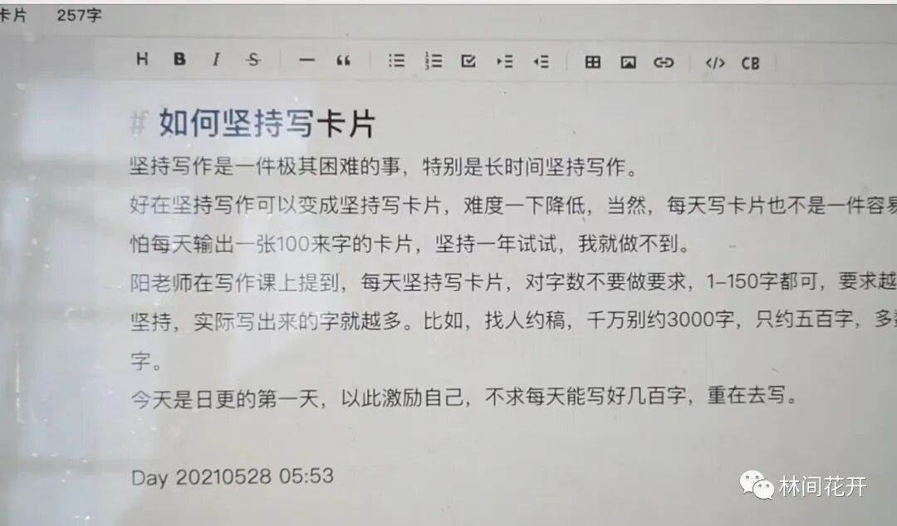

*（来自网络）*

## 1

每个人都有一口油井，有的大一些，有的小一些。

写作的过程好比挖油井。一开始并不知道有多少石油，你只要踏出第一步，去挖，挖着挖着，就挖到石油了。

写作也如此，不要去想太多，行动起来，扔掉草稿纸，不要想着你要设计好图纸再下笔。直接下笔，打破不敢写，写不出来的心理恐惧。把写作看成跟说话一样，把一切一切，混乱想法倒在纸上。

要敢于打破不敢写，不敢下笔的恐惧心理，把写作看成跟说话一样，把头脑中混乱的想法倒在纸上。

如何快写？要调动「自主心智」，这是认知科学家斯坦诺维奇提出的心智模型——「三重心智」。自主心智是人类进化而来的产物，看到蛇就会跑开，饿了就会找东西吃。自主心智有助于快写，先快快写，再用反省心智慢慢改。

在没养成写作习惯时，多写，沉浸到自由写作状态中，这种状态最接近作家的写作状态。在给朋友写信时，我最能体验到自由写作的状态，写作心流流过，就像挖到了一块汩汩流出的石油那般畅快。

谈到「犯写作困难症」问题，美国诺贝尔文学奖得主约翰.斯坦贝克曾建议他的朋友，去写诗，不写卖钱的诗，也不写用来读的诗，而是写用来扔掉的诗。以写诗走出写作的干涸期。

## 2

一个人挖油井，挖不动时，要找到一起挖的人，加入写作社群，在集体中写作。

5月份参加了一个读古诗的活动，每天花一小时，与小伙伴用古诗开启美好的一天。那段时间能坚持读诗，借助了集体的力量。某天无心读诗时，社群推着我，往前走，比我一个人靠毅力走，更远。

写作时，我也体验过这股力量。

去年夏天，想养成持续写卡片的习惯，加入九爷发起的卡片日更群，当时写的第一张卡片：

开启第一天日更卡片，我要求每天只写100字即可。放低写作门槛后，写得起劲，每次都能完成目标，少则300字，多则100字。

所以在写作前期，不妨降低写作要求，激起写作冲动，用一次次的小甜头（完成目标），去滚动更大的甜头。坚持半年日更后，写作习惯建立，不再恐惧写作。有卡片的积累，拼接文章容易很多。

约翰斯坦.贝克的做法有异曲同工之处，他提到：

> 不要想着“快了，我就要写完了”。忘掉那四百页纸，每天写一页就行了。这样下去，到写完的时候你肯定会大吃一惊。

前几天在一个活动课上，朋友说她今年制定了写公众号的目标。5个月过去，一篇文章都没写出来。我给她建议，以最小行动写作，写50字起步。不要一上来就写一篇公众号文章，任务过大，就会陷入行动瘫痪中。她听了我说的要求后，很兴奋，说今晚就去写。

如果找不到合适的写作社群，还可自创一个社群。为了能梳理家婆的传记采访稿，4月份我拉两个同学，建了一个「传记养成记」的小群，倒逼输出。

借助社群的力量，能给推着往前走，所以在还没学会自如写作时，不要远离写作人群，多加入写作群，与有写作爱好的人，在写作能量场中，以写作激发写作。

## 3

不积跬步，难以行千里。写作是一场马拉松，持续稳定的输出，远远大于偶尔来篇质量高的，从此搁笔。

朋友辉哥喜欢跑步，一年365天，不落下一天。在外出差，随身带着跑步鞋。他说，他要每天坚持跑步，而不是每周跑两三次，停歇几天就容易给借口钻空子。哪天天气不好，身体不舒服，没时间运动之类的借口，就跑了出来。有第一次，就有第二次.......一次借口就会蔓延到一周，一个月，甚至是一年，最后放弃跑步。

写作跟跑步一样，天天写，才思敏捷，灵感越写越有，一不写，就容易变成一口枯井。

但持续写作，都很难，如何坚持每天写？

阅读了「巴黎评论：作家访谈」系列后， 发现作家们都有一个特点——定时写作，代表人物村上春树，他把写作看成是一辈子必须做的事，建立了系统化的生活方式，住郊区，过起早睡早起的生活，早上四点一直写到九点，接着跑步或游泳、听音乐、看书，每天按步就搬，活成了行为主义学家斯金纳眼中的「合法的机器人」。

科幻作家郝景芳身兼多职，是两个孩子的妈妈；公司的老板；还是作家。每天的时间几乎给本职工作和童行书院占满。写作，只能靠每天早起，凌晨四点起来写作，起不来就五点，或者是六点，基本上很少晚起。在小孩七点起床前两小时是她写作的整块时间。她还利用白天的碎片时间，如等车、坐车的时间。

「意象的帝国」作者黄梵提到，除了定时写作，定点写作也很重要。

大多作家都有属于自己的写作空间，伍尔芙说过，每一个女生都应该要有一个独立的房间用来写作和抚慰情绪。

奥地利学派第三代领军人物米塞斯，初到美国，他的学术不被美国主流接受，没有学校愿意给他支付工资，只能靠过往的积蓄度日，几经搬家，米塞斯夫人回忆，住的公寓小到难于挤上两个人，但他仍有自己的一处写作空间。

世界上最高产的作家阿西莫夫，一生写出500多本书，他有个写作习惯，每到一个城市，就搭起一个小黑屋，不见阳光，专注写作，在这样的小黑屋中，完成了500多本书。

写作注定是一件孤独的事，99%要一个人完成，所以要找到写作最佳情境。我原本是一个外向合群的人，喜欢与人打交道，在写作这件事上，我变得内向疏离。有截止时间，且在空间狭小的情境，我的写作效率最高。最好的写作时间段，每天早上的五点到七点。

除了从时间和空间上改善写作情境，还有一个方法。

在某次写作课交流会上，俊雅教练提到，她创业艰难，为了能做下去，她想到了跑步，以跑步带动创业。只要能跑下去，创业也能持续下去。这是一种降维的策略。我把这个方法用在写作上，当我不想写时，就去跑步，只要跑了，当天就要写一张卡片。这么做有个好处，跑步和写作两不误，效率更高。

去年阳老师分享他的写书目标，提到类似的做法，他把写书跟减肥放一起，减肥五斤，完成一本书的书稿。

## ****小结****

春种一粒粟，秋收万颗子。

只要你去挖，你的油井就会越挖越多，越挖越顺畅。

村上春树罕见评价同行——日本作家村上龙，说他对写作有天赋，就像拥有一口离地面很近的油井，相比之下，他那口油井更难挖一些，但不影响他继续挖下去：

> 只不过我的石油储藏在地下很深的地方，必须不停地挖呀挖呀，非常辛苦，而且找到石油要花时间。可是一旦找到了，我就非常坚强和自信。我的生活是系统化的，一直不停地挖是件好事。

**changelog：**

**20220826 放置了三个月，重拾这篇文章，花了两小时慢改。**

**20220528 快写了第三个组块：如何让写作持续**

**20220527 快写了第一第二个组块，补充资料**

**20220526 拆解村上春树的金句，提取出核心意象词汇——油井，写作如挖油井一样，接着用再固定组块，快写了第一稿。**