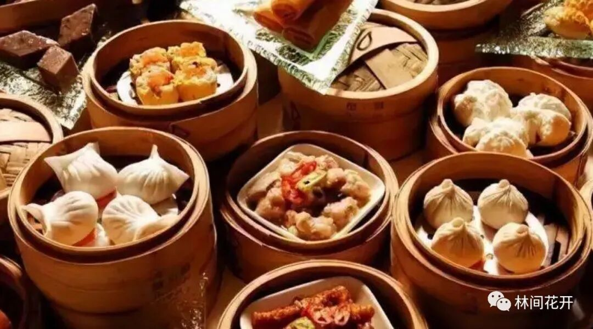
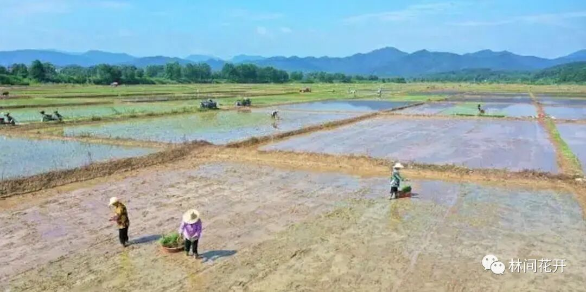
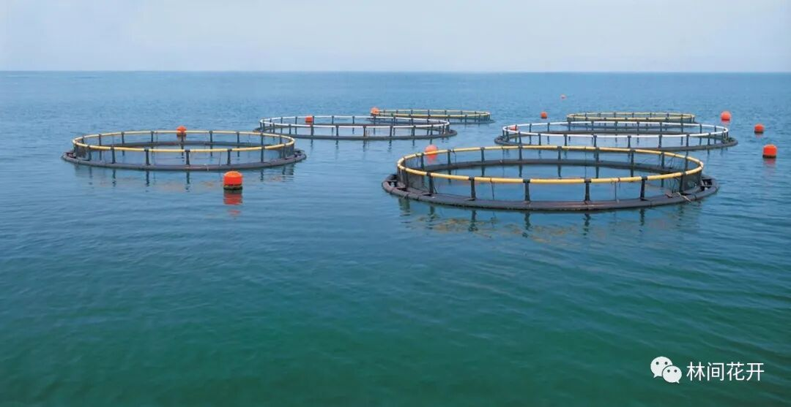

**写在前面：这是一份认知写作课的结业大作业。第一次尝试写人物故事，写的是阿英的故事，写她不论在何种恶劣环境下，都能勇敢活出自我。以下是原文。**

## 1

小孩开学那天，是阿英65岁农历生日。

如果说她有什么嗜好，那就是喝早茶。喝茶喝成了瘾，哪天不喝，周身不自在。她得了病后，也要阿生搀扶着去。

生日当天，阿生七点去霸位，要了一个临窗位。点上炉火，蓝色的一抹小火苗烧着，茶壶发出嗞嗞声，冒着热气，催女主人快点来。

窗外望去，一处红绿灯路口，绿灯一闪，人流如一群群小蚂蚁，匆匆往前赶。

“老豆，甘早，妈仔呢？”心抱（儿媳妇）一路小跑赶来。阿英病前多次约她，都给婉拒，得病后就不同了，电话一来，准能赴约。

“无甘快，她出门要个几钟。”他用手比划着化妆，顺手拉把椅子，示意她坐下：“不管她啦，我们先冲茶饮。”

下周是阿英最后一次化疗。前后做了五次，每次都要了她的命。年前查出晚期肺癌，做不了手术，只能化疗和吃药。多数人，化到第四次，第五次，顶不住，挂掉，很少能熬到第六次。

“这次能不能扛过，看她造化了。”聊到阿英的病，他没有十足的信心，皱着眉头，叹了口气。

“要不下周我陪她去？......”

还没说完，传来阿英爽朗的笑声：“阿嫂，早晨，比我仲早到。”

她拎着出街时常背的斜挎包，一头滚烫的头发，齐肩，几缕别在耳后，露出一对别致的金耳环。脖子、手上，也戴着金链子。算命师给她算过，她的命硬，要戴足金，才会走运。

穿着一件大红色旗袍，衬出二十七八女孩的身材，婀娜多姿。她爱穿旗袍，衣柜里就数旗袍最多。从夏天一路穿到秋天，天气转凉了，披上小坎肩，穿过秋天。

化疗后，她的头发没脱落，却白了不少。女儿素来知道她爱美，几番挑选，买了一顶长波浪型假发给她。经打理后，假发跟真的一样，带在头上，不仔细看，还以为是真发。

阿英出门前定是认真化了妆，眉毛往两边提，精神抖擞，一笑，眉毛跟着动，如蚯蚓在蜿蜒。朱红色的口唇饱满、立体，精致得像装上一样，随装随取。

“妈仔，下周我陪你去？”

“家姐说请了假，老豆无野做，力又大，也能陪我去。“她轻咽了口茶说：“嗰个地方，咩人都有，你都唔去喇，带好孙女紧要。”有些话她不便说，她是一个要强的人，不想外人看到她在医院失控的一面：痛苦、狰狞、丑陋，一个孱弱多病、狼狈不堪，即将快死的人，她自己都没法接受。她只想让别人记住，喝茶时的光鲜亮丽，那是她最好的状态。

## 2

阿英的病，多少跟出生有关。

她原先并不知道那天的事，只知道，母亲从没爱过她，眼里只有两个哥哥，捧在手里都怕融化。对她，连小狗都不如，好事没她份，干活只会找她：洗衣做饭，上山砍柴，下地耕田，样样都她。

10岁那年，哥哥娶了嫂子后，她的日子越发不好过。别人家的女儿活成自家人，有了侄子后，她就是全家人的奴婢。到了饭点，一家人围桌吃饭，只有她，抱着侄子，等嫂子吃完才到她。

有一天，下着濛濛细雨，她贪睡了半个钟，没像往常那样早早起来做家务。先起的母亲看到灶台冷冷清清，水缸空空，一堆衣服发出酸臭味。怒气冲冲走到她的房间，拎起来，劈头盖脸一顿骂："傻逼，什么时间了，还在睡，睡死你。"

她给抓疼，睡意全无，有点来气，顶了一句：“我是傻逼，你就是大傻逼啰。”

“还敢顶嘴，看我怎么抽死你！”母亲眼里有杀气，扯住她的头发拖往客厅。父亲听到她的哭叫声，上前问：“这是怎么了，有话好好说。“他要母亲松开手。

“不孝女，敢顶我嘴，今天不打死她，我就不姓梁。”母亲气得要把牙齿咬碎，把阿英推倒在椅子上，不准她动，脱了她的上衣，把两手反绑在椅子上。

“打死你，让你顶嘴。“母亲从厨房拿来烧柴用的一根树枝，不粗，打起来要人命。树枝落在阿英身上，像电流击过，过后还隐隐作痛，咬着牙，想要挣脱出来。母亲看到她反抗，抽打得更起劲，那股没发泄完的情绪如一只野兽，朝着她猛扑过来。

”不要再打了！我孙女快给你打死呐。“奶奶赶到，制止了母亲的毒打。

奶奶抱阿英回到房间，心疼地摸着身上的印痕，责怪母亲出手太重：”后妈都没这么狠心。“躺在床上，阿英无声哭着，任由眼泪往两边流，不去擦，渐渐就干了。

”奶奶，你告诉我，我是不是捡来的？“她声音虚弱，神情绝望。

”傻瓜，你是奶奶的亲孙女。”

“为什么要这么对我？为什么只对哥哥好，对我这样？”阿英捂着被子，抽泣声若隐若现。

奶奶才告诉她，出生那天，生下女婴后，母亲铁了心要扔掉，脐带不打算剪，要把她扔在1.2米深的水桶里，拿砖头压在上面，活活浸死。父亲苦苦哀求留下，她在床上，看都不看一眼。

奶奶想留下女婴。她生了10个小孩，送走3个女婴，没一个活下来，她不想母亲重走她的路。

她到母亲跟前说：”我现在去找算命师算一算，算完再决定去或留。“在奶奶出去到回来的三个半钟，女婴一丝不裹，脐带连着胎盘，身体一动，胎盘跟着动，就这么给晾着。

算命师说，她天生要戴金，命才会好，长大了还能照应父母。这条小命，才留了下来。

这次顶嘴，阿英遭受了皮肉之苦，却让她知道，她不是捡来的，仅仅因为女儿身，母亲不愿对她好。这多少让她有点不服气：又不是我要来这世上，怎么能怪我呢。转而一想，女儿身又怎么了，难不成我的命就不是命？注定我就比男孩差？我偏不信，既然成了千千万万条命中的一条，我的命也是命，不是别人的身外之物，不能再任由他人糟蹋，无视它的存在。

## 3

结婚这件事，阿英确确实实做了回主人。

她说：“如果不是我执意嫁阿生，我跟乡下那些女人没啥两样，结婚生子，伺候老公，服侍老人，我这一辈子就算完了。”

17岁那年，没经她同意，母亲擅自让媒婆介绍了一个男孩子，家在石头村的海边，年龄相近，仅此而已。两个年轻人还没见面，母亲就私下收了男方的200元订金。择好日子后，逼她成亲。

阿英怪母亲把她当私人物品了，眼里只有钱，养大了，就卖，根本不在意她的感受。她在家里，外人一个，长大了要嫁人，所以书也不给读，读了也是别家人的人。到了上学年龄，小学校长跟母亲说，阿英也该去上学了。母亲瞪他：“读来有什么用，还不是要嫁出去。”

读不了书，她还能接受，但要她跟一个不喜欢的人，过一辈子，她忍受不了，这一次，她想要为自己争取幸福。

那时她已经认识了同一个生产队的阿生，大她两岁，两人相谈甚欢。放工后，她与三五个姐妹去他家打扑克牌，一来二去，两人互生情愫，只是这层纸没有捅破，那个年代，不兴自由恋爱。一起玩得多了，村里人笑她跟阿生是一对，这话传到母亲那里，勃然大怒，她知道阿生家的情况，铁定给不了订金，钱比女儿的幸福更重要，坚持不同意两人往来。

想尽各种办法拆散他们，白天骂，晚上骂，句句不堪入耳：“你这个傻X，贪人家帅一枝花。婚前你搞大肚子，用猪笼推你下河。”村里有规定，婚前搞大了肚子，对家族来说，是一种耻辱，全村人会拿猪笼把你推到河里。女孩子很怕给推到河里，都不敢越雷池一步，村里也没发生过这样的事。

逼女不成，母亲只好变着法子诅咒她，搜遍了世上所有的毒话：“如果你执意要嫁他，咒你生不出小孩，拿锄头来锄。生出的小孩，个个残废。”村子原本就不大，这些话很快传到阿生的母亲那，她不准儿子再去找阿英，支走他跟老伴去韶关，当水泥工。

但母亲仍不放过她，催她成亲，一日不成亲，一日不得安宁。有次，阿英上山采完药材回到家，已中午一点多，肚子饿得咕咕响，看到锅里有粥，连喝了三碗。喝完，站在一旁的嫂子才慢悠悠地说：“妈在粥里，倒了洗碗水。”

她一阵反胃，想抠，抠不出来，对着大嫂干瞪眼。她气大嫂，联合着母亲一起虐待她，更气母亲，她干的活再多，都不如嫂子有地位。她想不明白，嫂子嫁过来时，怀了五六个月的身孕，母亲不嫌弃，还当她是宝贝。对亲生女儿，稍有不顺眼，打打骂骂。

想到自己的处境，阿英鼻梁酸酸的，想哭，硬是要流出的眼泪逼回去，稍振作了下，凑到母亲面前，不能再近了，一字一字从嘴里吐出来：“我——决——定——嫁——他，你——管——不——了。”

说罢，昂着头，笔直着从母亲身边过去。这次的「对峙」让她坚定了之后的生活，更有信心去选择她想要的东西。

留下母亲，气得跺着脚，指着背影骂：“你造反了，还想跟他在一起？不要再回这个家，当我们陈家没生这个女儿。跟他做鬼去吧。”

19岁那年，最疼她的父亲去世，母亲催得更急，刀子架在脖子上，就差抬她入洞房。她心灰意冷，不想再待在家里。娶了嫂子，两个哥哥全然指望不上。她想到了广州的舅舅，帮母亲找回失联的兄妹那年，她见过。

跟生产队开了探亲证明，次日，跟阿生两人上广州。

舅舅见了他们俩后，给母亲写了一封信：“阿生一表人才，白白净净，又老实，这样的人不嫁，你还要她嫁什么人。”批评了母亲一顿。

他也打消了原先要给阿英介绍广州本地男孩的念头，建议阿英：“干脆你在广州出嫁，我就是你的娘家人。”

她含泪点头，谢过舅舅。当天晚上，舅舅在家里摆了四围，来了40多人，一桌是舅舅家里人的亲戚，另三桌是他的工友。热热闹闹，从下午六点吃到晚上十点。随习俗，舅舅凑了些粮票，给她置办了脸盆、毛巾、牙膏、布料等生活用品，当她的嫁妆。

没有母亲和哥哥的参与和祝福，多少有点遗憾，但她终究还是按自己的意愿，嫁给喜欢的人，做了一回自己的主人，体验到了前所未有的，孤单的自由。

## 4

阿英的名声，多少是给母亲骂出名的。后来出名，是因为做生意。

婚后，两公婆没有跟着村里人，下地耕田。他俩在广州卖花生米和鱿鱼的小生意中，尝到了甜头。

提到生意，她脸上扬起自信：“一村人都知道我们两公婆做生意好叻，一度做到村里前三名 。如果不是水产厂执笠（破产），哪轮到陈子富（村里的人大代表）。我们发达时，他才开始卖花生米。”

生下大女儿，生产队解散，包田到户。村子靠近港口，有门路的人从香港运回海货，多是布匹、收音机，那时的时髦货。阿生有一帮酒友，经介绍，认识了香港老板，有不少工厂资源。

”利润好高，拿货一匹80元，转手卖给私人服装老板，220元，净赚140元。“明知阿生走私，阿英也没有阻止，她说：”这么好赚，谁会拒绝。”好赚的东西往往风险也大，如果给公安抓到，金额超10万元，就得坐牢。她抱着侥幸心理，做几笔应该没事的。

一匹到两匹再到十匹，半年不到，他们变身大老板运回整船（160多匹布），再分发给小老板，一船卖完，能赚个三四万元。卖完第二船货后，已经积攒了5万多元。村里人看到她两公婆，竖起大拇指说：“就他们俩厉害，识做生意。”得到村人的认可，也有名气，母亲对她的态度也有所转变。阿英越发不可收拾，拿了一批又一批货，总想着，做完这次，就上岸。

但老天爷不会一直给你好运。运回第三批货的那天晚上，县城的公安，三十几个人包围她家。

她一度怀疑是阿生的四哥四嫂走漏风声。

前一晚船靠岸卸货，中介马仔来家里通知阿生，他在房间里计数。四哥吃完饭，在老屋门口溜着牙签。

阿英当时在厨房炒着菜，听到马仔在外头对四哥说：“今晚八点，在沙湾卸货。”厨房的窗对着外面，她看到四哥疑惑地发问马仔：“沙湾卸什么货？”

赶紧从厨房跑出来，拼命给马仔使眼色，示意他不要再说。

“盯着我干什么，我跟你老公在交代事情。”马仔不耐烦，没理她，继续提醒四哥：“记得八点准时出现。”说完，就走了。

阿英神情慌张，对四哥说：“他肯定搞错人了，你当什么都没听到。”转头跑回屋，让阿生立即去追马仔。

她也顾不上吃饭，背着一岁多的小儿子，坐在阿生的单车后座上。那晚月亮躲了起来，青蛙也没叫，一路上很安静，她的眼皮一直在跳，预感有麻烦。追了半个钟，才追上马仔，她对马仔说：“不要在沙湾上岸，也不要在月亮口上岸，到白河靠岸。”她的直觉告诉自己，那里是最安全的地方。不出所料，公安在沙湾和月亮口守了一夜。

摸着黑，卸下160匹布，不敢直接运回家，把布分成几处放：60匹放在母亲家（离家婆家800米距离），50匹放在家婆房间，剩下的放在她房间的床底下。顾不上小儿子尿急，让他在她的背上尿。秋天的夜风吹来，背上冰凉凉。

货运回家后，她想着：这回应该安全了。第二天晚上，阿生像照常那样，送货给下了订金的买主，还没回家

“阿婶，你在算什么？”大伯娘饭后踱到房间找她聊天。还没分家，四个兄弟住在一个旧屋，每人一间，阿生分到角落的一间。

“在计数。”阿英没抬头，仍在对着数。

“还是你厉害，读了夜校就识计数。”大伯娘还问卖什么货，有一搭没一搭聊着。八点来钟，阿英闻到了一股烟味，越来越浓，下意识探头望出窗外，一群人穿着制服——是公安局的人。

她心跳加快，迅速把桌子零散的钱推到桌下，万一他在路口给抓到怎么办？大伯娘没出声，也没回房间，立在原地。大伯和家公都在家，跑出来看到公安，像是知道了什么，但没人捎话给阿生。

他出去时穿着平常爱穿的白衬衫，她还记得那时他斯斯文文的样子。

白衬衫走小路回，晚上黑漆漆，格外扎眼，快到家时，公安局的手电筒照到他衣服，大叫：“就是他。”

阿生掉头就跑。追了半小时，没追上，公安对着天空开了三枪：“陈生你再跑，我就开枪打死你。”一枪、两枪、三枪.......真的开了枪，枪声响彻空中，惹得全村人跑了出来。

有人说：“看到一个肥肥腾腾的人，像卖白粉的，嗖的一声跑了过去。”

也有人说：“那是老陈的儿子，抱着一捆东西不停地跑。”

阿生只顾着往前跑，黑漆漆的晚上，没注意到前面的一堵围墙。那是村人的一片果园，果子成熟了，主人围了石墙。阿生跑得太快，撞上墙，骨头撞断，走不了路，没法回家，趴在果园边上一晚上。时不时有手电筒扫过来，他闭着眼，大气都不敢出。

清晨回到家，阿英叫他自首，她说：“我盘算了下，全部的货加在一起，不足十万，不用坐牢，留条小命，再来过。”

公安局当天来清算，搜出100多匹布，3部收音机，用拖拉机拖走。交出5000元现金，加罚3000元后，家里只剩5角钱。好在不用坐牢，只拘留了15天。

满满一拖拉机货开走时，阿英没哭，家婆也没表情，母亲倒是哭了，哭天喊地，白花花的银子呐，一辈子都赚不到这么多，一夜之间就没了。

”不要学我哋走私，没有好下场，不得好死。”他们给公安带走前，坐在拖拉机上，从村头到村尾绕村一圈，当街示众。谈及那次「游行」的情景，阿英又笑又哭。

路过自家门口，大伯娘他们在边上看她热闹，笑得格格响。阿英咬着牙，心想：你们笑就笑吧，只管笑吧，我才二十几岁，我是不会输给你们的。

## 5

拘留出来后，阿生整个人闲了下来，水烟一管一管地抽，酒整瓶整瓶地喝，日夜颠倒，不闻家事，他试图麻醉自己，忘掉那段有污点的经历。你问他，小孩几岁时，他支吾着答不上来。一家人的吃喝拉撒全落在了阿英身上，三个娃，大的只不过7岁，小的刚过3岁。到了饭点，闻到伯娘家飘来的饭香，他们三正要跑过去，给阿英训斥：“都回来，不许去。”日子再苦，也不能让伯娘家看衰。跟米店老板赊了米，总算解决了家人的肚子，她也做点零工维持生活。

夜深人静时，她想到了做生意，这个念头，从没断过，只是家里锅都揭不开，哪有钱做呐。

一次转机出现。一个要好的姐妹，全家南下深圳，养了一窝鸭宝宝没人看管，想转手，100来只，30元。阿英很想接手，耐何手上没钱给到，她想了个两全的办法：“延后一个月，加到40元，如何？”姐妹原本不急着用钱，多了10元，就答应她宽裕一个月。

鸭子养到三个月，卖了400元，数着钱，她按捺不住内心的小火苗，跟阿生说：“再借点，我们做回水产吧。”阿生消沉了大半年，也想找点事做，但他有些顾虑：本钱从哪来，这半年他没赚一分钱。

“喏，这是卖鸭子的钱。再贷点。”阿英胆子大，她想到了银行贷款。他们的名声有「污点」，银行是贷不到了。阿生点头同意，他想着，做老本行，合法合规，对他来说，轻车熟络，是可以再拼一把。这次做事，他稳妥了些，在一家做得红火的水产厂，做了一个月的临时工，摸清了门路。

一个月后，阿英从朋友那借了高利贷，凑齐了2000元，办了水产厂。

两人分工明确，阿英兼顾三个小孩，留在厂里管工人，工人由最初三人到后来扩到二十多个。每周运回来一船鱼仔，分类、去头、洗净、晒干、打包，装好一箩箩后，拖着三个小孩再把货运往广州。阿生长期待在广州对接，货一到，就批发给海鲜市场。

做水产不到一年，赚到了钱，阿生在广州住要住最好的——五星级宾馆，那时他最风光的时候，如果不是后面借钱的事，估计他们早就是村里最有钱的人，但也就没有后面的故事了。

“冚家富贵！钱都给他败光了，当初不是他，把钱借给吴老板，我们早就发达了，哪还要搞建筑。”阿英谈起当年事，意难平，爆了粗口，她说的「他」就是阿生。

阿生原本不认识吴老板，一次与同村人在酒店附近喝小酒，刚好吴老板也在，带了个靓女。同村人介绍，说吴老板也是同乡人，家在市中心，建了一栋别墅，做兔毛生意，一车卖完能赚上好几千元上万，最近多进了货，手头有点紧。阿生爱喝白酒，又喜欢装大佬，酒精加持下，听到吴老板开口借钱，爽快答应借15000元。那可是他全部的本啊，原本过几天要汇回去给阿英拿货的。

“姓吴的，好死不死，平时不往来，借钱就来找我们。说好二十天就还，三年了影子都不见。借条也不写，写了还能追他家人要，你说蠢不蠢？”

幸好卖完货，她带着两千多元回家，发完工人的工资，没有本钱再经营鱼厂，只好遣散工人，关了厂门。高利贷债主听到风声，三三两两来追债。阿兰欠得最多，生意好做时，她主动送钱上门，总共欠了一万八，三分利，利息都够她生活开销。落魄时，她追债追得最勤，好声好气跟她解释：”吴老板家里有一片树山，砍了树，还了钱，就先还你。“

“你这个骗子，鬼才相信你，我才不信砍什么树。”好说歹说，阿兰不依不饶，催得更频繁。

“为这事，我死过两次。”阿英吸了吸鼻子说：“做生意那几年，赚赚亏亏，走私我赚到大钱，也跌进谷底，钱没了，我还爬了起来，但水产这次，真的很惨，钱没了，还要还高利贷，利息那么高，怎么还？”

阿兰白天追，晚上追；家里追，路上追，只要见到阿英，朝她吐口话，骂脏话，看到她穿着裙子，骂她是街女。后来阿英去了玩具厂上班，她也追到厂里，拉扯她出厂门口要钱，厂里的工人都知道这事。村里的人看不下去，劝她：“阿兰，追追就算了，不要弄太过分，人家有钱了，自然会还你。”

阿生不敢回家，躲到大姐家，呆了半年后，广州的舅舅让他跟台山老板砌砖。留下阿英独自面对一切。

有年初一，村里唱戏，家公家婆晚上七八点去看戏，留下三个小孩在家，大女儿10岁了，能照顾弟弟，一座老屋就他们三人。刚好家里停了电，鞭炮声不断，三人害怕。姐姐拉着两个弟弟，要去厂里找妈妈。

那是梅雨季节，下着毛毛雨，绵绵的。没有路灯，过马路时，一辆货车，打着闪光灯，没看到三个小孩，往前开着。

厂里的姐妹叫阿英早点回去，陪小孩过年，剩下的她帮做完。阿英一出门口，那雨在空中飘着，如冬天呼出去的气，看不清，只看到三只鬼影子，头发湿淋淋，隐约听到小孩的声音。

小美，小美！！阿英冲了过去，用了全力扑倒他们。货车及时刹车。差一点，就撞上。晚一秒，后果不堪设想。

司机下车后，扯住她的头发：“他妈的，你想找死，也不能这么害我吧。”

“老细，我没有寻死，是小孩要过马路，没看到车，我推倒他们。”那个位置刚好是盲区，又下雨，司机看不到小孩，以为她冲过去是寻死。司机下车，走到小孩身边，帮拉他们起来说：“没事了，没事了。”

安顿好三个小孩睡后，她了无睡意，想到晚上发生的事情，给人日日追债的情景，眼泪就来了，就这么给流着，也不擦掉，干了又流，流了又干，整张脸像从水里捞起来的一样。

从柜子里拿出一件，在广州结婚时，舅舅买的陪嫁衣——一件天蓝色小碎花旗袍，她平时不舍得穿。穿上后，整理了头发，画了眉毛，擦上口红。没有开灯，在月色下，她径直来到厨房外边的菩提树前，踩着凳子，绳子系在树干上。她不放心地回到房间，望了一眼三个小孩，轻轻的鼻息，一呼一吸，睡得真香，看着他们，眼泪扑扑又来了。双手掩住脸，对着屋顶，在心里大声喊着：母亲救救我，我快不行了。她想要的母亲跟实际的母亲是两人。在泪眼泪眼婆娑中，她看到：母亲追着她骂，诅咒她生一个死一个，死不了就残废，出门走路给车子撞死。想到母亲，她就有了活下去的力气。她收住眼泪，不能再让母亲的话生验。

收好绳子，回到房间，看到大女儿翻了个身，二儿子流着口水，小儿子趴着睡，他们都不知道那晚发生了什么。

折腾了一晚上，阿英累了，衣服没换，就这么侧身躺下，跟小孩并排着睡，一觉到天亮。那晚的月亮，一直停留在树梢上。

## 6

对死过一回的人来说，之后的日子没有什么可以击倒她，即使后来她上广州吃了很多苦，对她来说，那只是小山坡。阿兰还是天天来追债，用粗俗的话当街骂她，推搡她。她不再躲避，只是用冷漠的眼神回击她，也不再折磨自己。只是，她厌倦了这样的生活，这里的人，这里的事。她想换个地方重新开始。

跟阿生商量后，她决定带着小孩上广州。那一年，还有两天就要过农历年。阿生回到家，是晚上十点多钟。欠了债后，他从没白天回过家。

买好了上广州的车票，匆忙中挑了几件常穿的衣服，10来斤米，坐上开往广州方向的车。阿英头也不回望一眼，前半生发生的一切，在夜色中，给甩到车后。

母亲变卖了她的家具，后来生病，也跟着上广州治病，在阿英家生活了大半年。原本一家五口挤在8平方的出租到，脚都伸不直。每次做饭，薰得眼泪直流。母亲来了，挤到呼吸的空间都不够。唯一的一张床让给了母亲，她和三个小孩在地上打地铺，无处安放的脚伸到床底下。

到广州的前两年，阿英顾着带娃，偶尔做点零工，全家的支出靠阿生做工程养活，支付完母亲的药费，日子过得紧巴巴。

直到一天，她去工地找阿生，没找着，工人说：“跟人在房子里喝酒。“找过去，在刚建好的那栋房子，躺着睡觉，一身酒味。家公曾提醒她，阿生这人什么都好，就是爱喝酒，跟吃饭一样，做工程就不可以这样了，会出事的。

有了之前做水产时借钱的前车之鉴，阿英决定从阿生手里接过工程，两人共识，她管人管钱，他负责技术。

“村里百来套房子都是我们建的，谁都认得我。你看的那所幼儿园，整栋楼，二十年前建。”说到建房子，阿英眼睛闪着光。她接工程有自己的一套，从不去人家家里谈，只上茶楼聊。

“冇工程做，我就去饮早茶，饮完茶，就有嘢搞了。”她喝早茶的习惯，是做工程后才有的。村里要建房子的业主几乎都爱去茶楼打发时间。她找机会跟业主拉家常，拉着拉着问到他们找了哪家工头。问清价格后，她压低价，撬走工程。其他工头知道后，又气又恨，拿她没办法——她在村里有亲戚，又认识村里的大队长，只能背后碎她几口，这个女工头太可恶了。

“2015年那两年最好赚，工程、工人都顺利，业主也不拖欠。”做了二十多年，什么事情都有：工人贪恋美色，抬头往窗外多看了一眼靓女，踩空凳子，从三楼掉下去，摔成重伤。赔了两三万；工人与工人发生口角，常有的事，两人打起来，打进了医院，又赔了几万......每次开工，心惊胆战，只有把工程做完，让业主验收到过，才算做完工程。“她承认建筑这事风险大，但利润可观，做完一套，净赚十几万，二十多年，收收买买也有近百万，足够她下辈子生活了。

“我留着一口气，把工程款都追回来，仲有二十几万。”

“趁这次生病，干脆一次追完。”心抱建议。

“不得，逼得太紧会遭报应，每年分红（村里年底分红）追点就算数了，人哋又唔系唔还，有钱就会还了。”她给阿兰追怕了，逼得她「死」了两回，逃到广州后才脱身，给人追钱的感受太不好受，她不想做得这么绝。

“我嗰阵（那时）已经没钱了，无办法，东家借西家还，还了她一些钱，她都只当是利息，利滚利，一世都还不清。“

在60岁那年，子女想要她安享晚年，纷纷劝她：”妈仔，不要再做了，我们养你。“

阿英不想放手，想再赚点再赚点，多做一年有多一年的钱。不过她还是听了子女的话。卸下包工头的身份，仍留着水泥搅拌机工具，想着哪天还能用上。

闲下来后，她只要去喝茶，事情就会找上门来——拆房子、建房子、买材料，弄个下水道，都会找她。她认识人多，一个电话就能找到人接活，两头赚中介费。少则几千，多则上万，靠这些积蓄，她的日子过得轻松自在。

”比做工程好赚，轻松，不用爬上爬下（楼梯）。眼下就盼着这副身体能好起来，干点活，不拖累你们。

“她说，每年七夕，回老家跟姐妹聚会，她们都夸她是最叻（厉害），天生识做生意。

在她姐妹中，她是活出了头。

## 7

“阿嫂，晚上带埋两个孙女过来吃饭。”

国庆前，阿英做完第六次化疗，身体恢复快，脸水肿两天后，消退，胃口大口，能吃能睡。早晨走去喝茶，利索，高跟鞋咯咯声响。

她视这次化疗为一次重要的里程碑，跟家人讲，身体恢复原状，病毒给赶跑了，以后不要再拉她去医院，那个鬼地方，不想再去。

阿生翻日历，挑了良辰吉日，邀请女儿女婿和儿子两家人到家里庆祝。

那天，她早早起来，和面粉，备生蚝、虾、鱼仔，炸了一锅煎饼——在老家逢年过节才吃，还做了拿手菜卤鹅、白切鸡、猪杂汤。这是她三十年来，第一次下厨。圆型八仙桌，摆满十二个菜。

小孙女站在煎饼前，口水欲滴，正伸手去拿时，阿英用手指示意她：“一会拜过祖先再吃。”她烧了三支香，双手合十，对着茶几旁的陈家祖宗牌位，念念有词。

每度过一个难关，她都要还愿，告诉自己，生活要往前看。