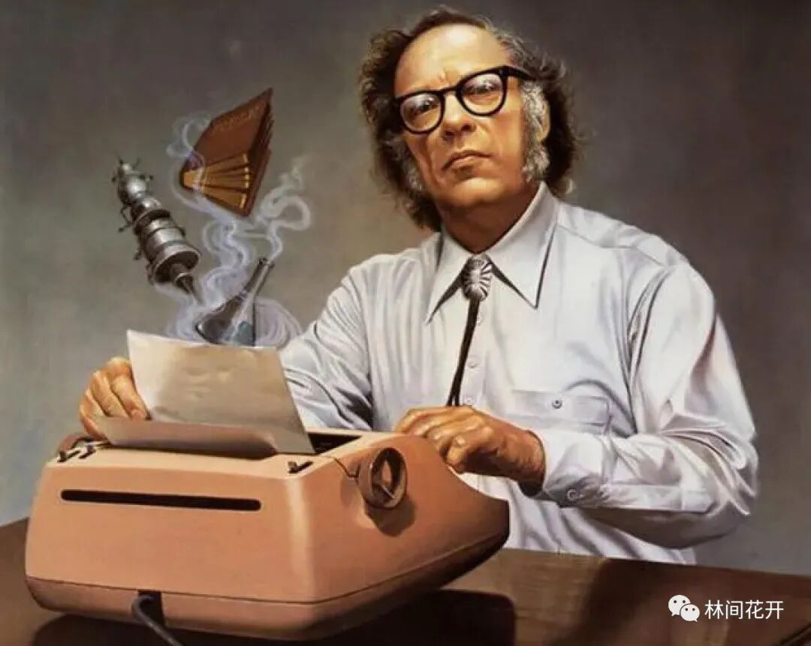

一生写出14本书，厉害吗？

当然了，对大部分作家来说，很厉害了，但对阿西莫夫的妻子珍妮特来说，远远不够，因为她对标的是丈夫阿西莫夫的作品数量。14本？连他的零头都达不到。

**（来自网络）**

## ****1****

阿西莫夫是谁？

他的全名艾萨克.阿西莫夫，出生于1920年（跟张爱玲同年），他是一位享誉全球的俄裔美国科普作家巨匠和科幻小说家。知识渊博，著作惊人，在他72岁去世前，一共出版了470部作品，内容涉及自然科学、社会科学、文学艺术等领域，可以说是一个百科全书式，神一样的人物，他还曾获得科幻界最高荣誉奖：雨果奖和星云终身成就大师奖。

据他自传中所载书目分类统计，470本书中：非虚构作品269种，科学总论24种、数学7种、天文学68种、地球科学11种、化学和生物化学16种、物理学22种、生物学17种、科学随笔集40种、科幻随笔集2种、历史19种、、有关「圣经」7种、文学10种、幽默与讽刺9种、自传3卷、其他14种；虚构作品201部，含科幻小说38部、探案小说2部、短篇科幻和短篇故事集33部、短篇奇幻故事集1部、短篇探案故事集9部、主编科幻故事集118部。

光是自传，阿西莫夫在生前就写完三卷，前两卷分别是 「记忆犹新」、「欢乐依旧」，在1979年、1980年前后出版，严格按照时间顺序写，从出生写到1978年的经历，记叙多，议论少。

第三卷「人生舞台」，他在1990年住院时动笔所写，写了125天，23万5000字，同年5月30日完成，这对大多数作家来说，写出这么一本大部头的自传，是件困难的事，当时他已病重，还要做很多其他事情，但他还是在去世前完成了这事，或许如他说，写自传是他那时最有兴趣的事。第三卷不是前两卷的续集，内容和结构都有所不同，他没有按照严格的时间顺序写，而是按思绪走，一个话题接一个话题，看得出，他是按他的记忆去还原「情景」，写了166个话题，700多页。

在自传中，阿西莫夫娓娓道来他的家庭，开糖果店的父母、与书为伴的童年、求学之路、学校、成长、求职、工作、挫折、恋爱、亲朋好友、演讲、写作、生死、战争等。这本书自传写得坦诚、朴实，一眼扫过去，有点流水账，也就只有阿西莫夫的流水账写得这么真诚，动人，看完后，迫不及待想看他的科幻小说。

## 2

看自传前，好奇阿西莫夫多产的秘密是啥？读完后，我从书中中找到答案：热爱、专注、作品意识强。

他父母经营着一家糖果店，没空管他，给他办了张图书馆的借书卡，让他自己借书看，书成了他最好的玩伴，宁愿一个人安静看书，也不愿意去找其他小朋友玩。

在11岁那年，他写作的念头，来自看了一些好书，这些书不属于他（要还图书馆），他想到了以抄书的方法保留内容，抄了几章后，方法不可行，有了写书的念头，写下后能永久保存，输出是为了更好的记忆。看的低俗杂志的小说多，他就从低俗小说开始写起，反而帮助了他，这类小说的门槛低，又最缺稿件，他写的故事发表了，这对刚踏入写作领域的新手来说，激励人心。

明确了写作这事情后，他把写作放在了第一权重，写作甚过做其他任何事情，他可以一天在打字机上工作12小时都不觉得累。为了写作，他可以不外出，不去旅游，为数几次不多的旅游还是陪妻子，其他时间，几乎用在写作上。他甚至不喜欢天气太好，如果是阴天或是下雨天最好，他就不用陪小孩出玩，可以在家写写写。

阿西莫夫说他幽闭症，白天也要拉上窗帘，弄得跟没窗户一样，打开台灯，专注在写作的小世界中。他把这种与写作相处的方式称为幽闭症，我更想看成，他对写作的一种专注，以窗帘和台灯隔开有噪音的外界，沉浸在自我的写作中。

当一个人在一件事上投入过多的时间和精力，在另一件事就显得有点笨拙了，阿西莫夫说他玩不好棋牌，也没有擅长的运动，他说，别人把棋子的移动看成了一种模式，而他没在下棋上花时间，看到的还是棋子的移动，他在写作上，把文字看成了模式，这是他擅长的。

有次周末，他在上午接待了两拨人，接着陪妻子看了会电视，没做多少事，以至当拜访他的译者问他一天花在工作上多长时间时，他诙谐地说：“为此（没做多少事）我还挺伤心的呢。”

## 3

作家最怕的就是遇到写作障碍，面对空白的屏幕，一个字都写不出来，或是写了删，删了又写，几个小时过去，还是空白的文档。

阿西莫夫说他不曾有写作障碍，其实是有遇到过写作障碍，只不过给他巧妙地跨过了。

他说，如果一次只写一本书的话，他肯定是没法避免写作障碍，但他不会每次只写一本书。在他写一本最难写的科幻小说时，他也会有厌烦，无法再写一个词，但他不会继续给逼疯，在那里冥思苦想，而是把小说放置一边，去写手边其他十几种东西的任意一种，写一篇评论，小品，或是非小说的书，等写作状态回来后，他重新去写先前给搁置的那本书，那时，他又有写作的欲望。

他这种随心所欲的写作态度，让我想起「反脆弱」的作者塔勒布，他提到，自发阅读和课堂阅读的区别，前者阅读的书目是自己选择的，当你厌倦读一本特定的书，但你不会厌倦阅读本身，换一本继续读，而不是放弃阅读这件事，后者就不同了，如果你只读学校的教材时，一旦觉得无趣，你就会有一种完全想放弃的念头，什么都不想做，或是想用逃学来摆脱这种沮丧。

在别的作家写完一本书，可能会休息上一阵，完全不写，等到想写时再写。阿西莫夫不是这样，他从未停止写作，对他而言，写作不是正襟危坐在桌前，离开桌子后，以及他在吃饭、睡觉、洗澡的任何时间，他的脑子都还在写作，等他再坐回桌前，脑中已有了安排，他无需酝酿，直接打字就可。由此看来，写作最好的途径就是写作。

为了写得快，阿西莫夫采用一种平实，偏口语化的写作风格，这样写起来很快，也很少出差错。他用镶嵌玻璃和平板玻璃来比喻两种不同的写作风格，前者是华丽的风格，漂亮，过度修饰，显得晦涩难懂，无法让读者看透；而后者看似不漂亮，直白朴素，不加修饰，反而能让读者读懂，这是他想要的一种风格，但这种写作风格不容易写，要有一颗清晰的头脑，有条不紊的，还得要有熟练的写作技巧去梳理思绪。

有人问：“你哪来那么多的灵感？”阿西莫夫回：“我思考，思考，思考，再思考，直到把自己杀了。”“尽量多动脑筋多想。”保持思考，这就是他灵感的来源。

## 4

作家中不乏有热爱和专注的特点，但像阿西莫夫这样，持续高产的作家却是少之又之，为何他能做到如此多产？在看到他讲选编、注释那两章，我立马意识到，这是阿西莫夫比其他作家更渴望出版书的数量。在他42岁，出版了46本书后，他开始意识到，他这一辈子在写作上最重要的事情就是出版的书的数量。他希望，他能因出版的数量而给人们记住。事实证明，他确实是以出版书的数量巨大和写作题材范围之广而著称。

如何让出版数量上去？

他在「选编」中提到，科幻迷选编的故事集里有他的内容，这些故事集以前是没有序言，连主编一句话都没有。他想到了一个好主意，在这些选编的书中，用心写了序言和长长的导读，这样，原先只是选编的书，也变成他的一本书，可以合法添加到他的出版书目中，成为470本中的其中一本，以编者身份编写的书籍数量占到1/3以上，真正以作者身份写的书，可能不到300本。

阳老师在「创作你的第一本书」中提到，写书新手在出版第一本书时，可以先成为编者，编写民间故事之类的书，这样反而更容易出第一本书。

阿西莫夫还有一个聪明的做法，有次他在二手书店看了「唐璜」后，想到了给这本书写注释，一发不可收拾，在之后，他还给「失乐园」、「格列佛游记」写注释，写下好几本，成了一个系列，不管是写书、选编、还是注释，他都有很强的作品输出意识，最终增加了他的出版数量。

阿西莫夫视写作为生命，写就一本本著作，他说：“我不自怜，我不会去想将来可能会怎么样。就像哈里。塞尔登一样，我可以看见我周围堆满自己的作品，我觉得很欣慰。我知道自己曾经研究过，想象过，也写下了许多种可能的未来——我仿佛到过那么似的。”

## 小结

> 如果你曾经很投入地生活过，那么疾病、年迈、死亡都不可怕。即使你不能活到老年，它仍然是有价值的。能够投入到生活中去就会有快乐，投入到富有创造性并且有人与你分享爱的生活中，就更加快乐了。---艾萨克.阿西莫夫

写作于阿西莫夫，真的是一件快乐的事。

在他去世后，珍妮特找到他病后写的一张纸，上面写着：

> 40年间，我平均每10天售出1件作品，

> 其中后20年，我平均每6天售出1件作品，

> 40年间，我平均每天发表1000个词，

> 其中后20年里，我平均每天发表1700个词。

读完阿西莫夫的自传，我对写作又多了一份敬畏之心，也找回一点点写作的热情。

**changelog**

**20221230，断断续续读了阿西莫夫第三卷自传「人生舞台」 ，写下读书笔记。*在读的过程中，受他的写作热情影响，把丢失的写作，一点点捡回来。***