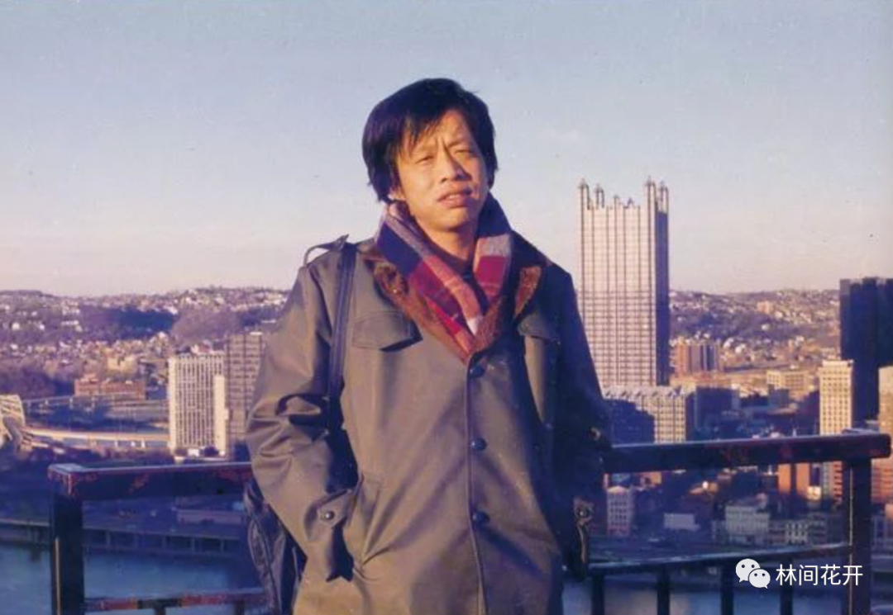

有一句话在文坛广为传颂：“男生不能不读王小波，女生不能不读周国平。”

身为女性读者，我同样热爱王小波的作品。

就在26年前的今天，王小波英年早逝。直到多年后，我才开始阅读他的著作，从杂文集《沉默的大多数》、《我的精神家园》、《一只特立独行的猪》一路读到经典作品《黄金时代》。

他曾为自己写下这段简介，成为之后所有书籍的官方介绍：

> 王小波，1952年生于北京。

> 1968年到云南插队，后在山东转插，做过民办教师。

> 1973年在北京当工人。1978年考入中国人民大学本科，1986年获得美国匹兹堡大学硕士学位。

> 1988年回国，曾在北京大学、中国人民大学任教。1992年辞职，成为自由撰稿人。1997年4月11日病逝于北京。

最初知道他的有趣，是读了阳志平老师的《风格练习》，把他视为有趣的代言人。阳老师总结了“何为有趣的人”，其中包括三个标准：

> 有趣的人，在于偏离；

> 有趣的人，在于内在动机；

> 有趣的人，在于风格；

王小波的有趣之处在于他的偏离，他不会用世俗的眼光看待自己。例如高考恢复后，即便已超龄，他仍选择高考，最终考入人大；后来成为大学教授，在人们看来，这是份体面的稳定职业，但为了写作，他放弃了教职，成为了没有经济保障的自由撰稿人。

他的作品得不到主流界的认可，大部分著作在他去世后才得以出版，他也没有获得经济收入，他仍然坚持写作，而不是像其他文人那样选择转行做生意。这点上，跟当年在家学拍电影的李安有点像，但他们都是自信的，确信能出圈，只是王小波的出圈来得有点晚。在他去世后，他才得到世人以「历史上独特的一个人」来记住他。

说到他的偏离，还想提及一点，在他与李银河结婚前期，两人商定长久过一种丰富的精神生活，决定不要孩子。他们放弃了平庸的世俗享受，在精神餐桌上大快朵颐，这是世俗中的人难以企及的。

王小波有趣在于他的内在动机，阅读也好，写作也好，他始终在意的是他的进步，而不是外在的财富和名利，如果要追求财富，以他理科男的身份，完全可以在学术圈混，或是成为一名程度员，他是最早一批捣鼓编程的人。

王小波有趣在于他的风格。他不是到了30岁，40岁才有的阅读习惯，而是从小就嗜书如命，他的哥哥王小平说：

> 小波自幼嗜书如癖。不管什么书，但凡是能看得下去的，就双手捧着，仰歪在床上，看得昏天黑地。有时候在地上捡起一张带字的纸，也翻来翻去，看得津津有味。

写作习惯也如此，率性也如此。初读他的文字，真诚、不拘一格、天马行空，很敢说真话，没有仇恨，没有悲伤，用他荒诞的笔调书写当时他所处荒诞的时代，他的真和敢，造就了他特立独行的气质，成了他独有的风格，很难把他归到某一类作家中。

他旗帜鲜明反对无趣，反对庄严肃穆的假正经，在《沉默的大多数》自序中主动提及他想要过有趣的生活：

> 我对自己的要求很低：我活在世上，无非想要明白些道理，遇见些有趣的事。倘能如我所愿，我的一生就算成功。为此也要去论是非，否则道理不给你明白，有趣的事也不会让你遇到。我开始得太晚了，很可能做不成什么，但我总得申明我的态度，所以就有了这本书——为我自己，也代表沉默的大多数。

王小波的文风深受西方作家影响，观点独特有趣。最早接触《情人》这本书，我是读了他的《我的师承》以及《我对小说的看法》，才看了杜拉斯的作品。

在其他作家推崇读古典文学时，他独辟蹊径，给读者提供了一条鲜为人知的文学路线——要读好文字最好去读翻译家的著作，如王道乾翻译的《情人》——杜拉斯晚年作品；或是穆旦翻译普希金的《青铜骑士》，他们的文字是黄钟大吕，要用来听，用来读，还有卡尔维诺的小说，米兰.昆德拉的小说，读起来极为悦耳，像一串清脆的珠子洒落地上的声音。

王小波的文字有趣，还在于他的反讽和黑色幽默，总能把两件不相关的事，扯在一起，起到强相关，即使是在抱怨，也抱怨得诙谐有趣，看得过瘾。

在《卡拉OK和驴鸣镇》一文中，他住所的住户从早到晚，唱卡拉OK吵到他睡不好觉，他讲了一个故事，用来批评这种现象，讲的是堂吉诃德和他的侍从在途中，碰到一乡下人寻找丢失驴的故事，意味悠长，来一段结尾：

> 我总想提醒大家一句，人在歌唱时听不到自己的声音。在卡拉OK时，面对五彩画面觉得挺美时，也许发出的全不类人声。

> 茶余酒后，想过把歌星瘾时，也可以唱唱。但干这种勾当，最好在歌厅酒楼等吵不着人的地方；就是嗓子好，也请把嗓门放低些，留点余地——别给餐厅留下“驴鸣餐厅”的恶名。

论长得帅，王小波沾不上边，论有趣，有他在找不出第二人。他还是一个恋爱高手，他与李银河结合，早期可以说是高攀，没有人家的颜，也没有人家的学历和地位，但他的才情和有趣摆在那，读了《爱你就像爱生命》，我都要羡慕李银河了，她是何等幸福呀。每封信件，写得那么直白，炽热，有爱。

> 我把我整个的灵魂都给你

> 连同它的怪癖

> 耍小脾气

> 忽明忽暗

> 一千八百种坏毛病

> 它真讨厌

> 只有一点好

> 爱你

李银河说，她最喜欢这句：“你要是回来我就高兴了，马上我就要放个震动北京城的大炮仗。”书中还有不少情意绵绵的话，让人脸红心跳。

喜欢王小波的人甘心如诒，不喜欢他的人摇头不已，这些人当中，只有两派，支持他的，和不支持他的，但不可否认的是，在他去世后，他获得无数的赞誉和追捧，无数青年想成为他的「门下走狗」，视他为偶像的存在，他的文字也反复给人提起，咀嚼。

为什么王小波会得到这么多人的热爱？

王小平提到王小波的文字不太驯顺，得不到身居要津人物的提倡，又常率性而为，难以成为大众茶余酒后的娱乐，大众之所以喜欢他，是因为：

> 人们之喜欢他，是因为他的那种独特的感受世界的方式。他就像一扇门，透过这扇门，可以进世界的另一面。

王小波受欢迎，不只是因为他的文字技巧，也不是他建立了某种思想营垒，而是因为他独特的感觉和品味。他以灵敏的鼻子捕捉到从这个世界里透出的，他人难以分辨的种种气味，并把他们制成了「香水」。

如果王小波还在世，他还会继续写作吗？这只是我的一个奢望，幸好，在他逝世26年后，仍然继续读他的文字，读到他的有趣。

ref

王小平「我的兄弟王小波」王小波「我的师承」

阳志平「风格练习」