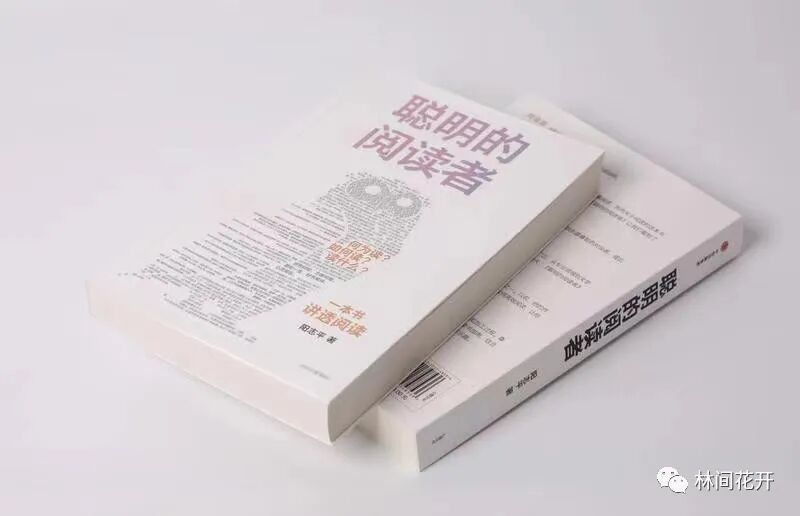
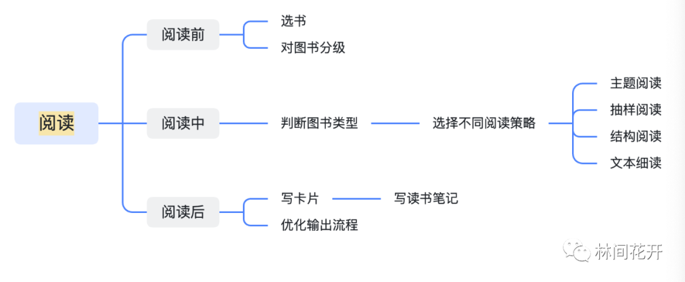
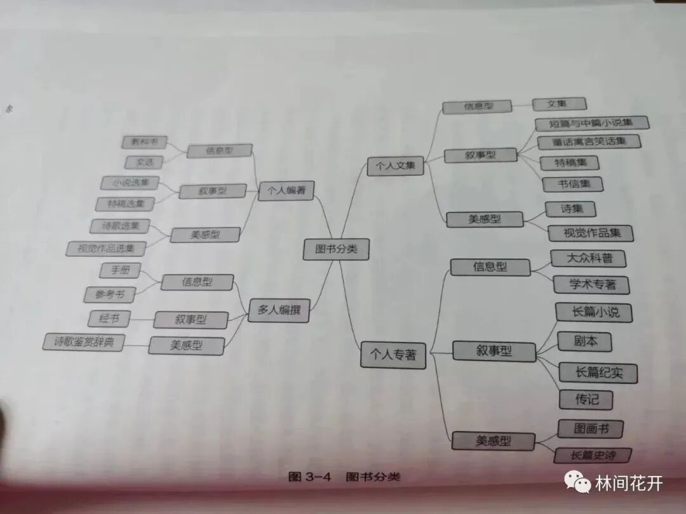

买书速度远超阅读速度，家里几百本书等着我读，但我的阅读速度上不去，数量也上不去。

而阳老师比谁都忙，身兼多职，是公司老板，是老师，是咨询师的督导，是作家，手头几本书在写，同时是一名父亲，还能保持大量的阅读和输出，他是如何做到的？

前几天读了阳老师的第一本讲阅读的书《聪明的阅读者》后，我找到了答案。

阳老师是典型的聪明的阅读者，手里有一把阅读天梯，能灵活使用多种阅读策略，快速获取知识，在数量和质量上都碾压他人。而普通人的阅读过程，就像站在山脚下，仰望着阅读山峰，没有梯子，只能艰难徒手攀爬，迷失在复杂的文字和过载的信息中，无法抵达岸。

## 1

如何才能像阳老师一样，成为聪明的阅读者？你需要构建一个阅读系统，包含：阅读前、阅读中、阅读后三个阶段。

众多好书中，聪明的阅读者根据自己需求选书，编制书单，而非依赖他人推荐。阳老师总结了一个选书公式：图书价值=内容品质+版本价值+社会评价+内在动机。

他在多个平台发布了无数书单，包括育儿百书、开智正典和寻找牛人与智者清单等。不同学习体量需不同约束。大书单追求广博，至少100本。然后根据重要性或受欢迎程度精简，生成小书单。

编制开智正典和寻找智者清单时，阳老师会列出淘汰标准。他盘点了上万本传记，选出20世纪200多位杰出人物。我去年阅读的传记清单就基于他的智者清单购买。

有趣的是，想在赵元任和钱钟书中选一个，阳老师让两位高手PK，胜者留下。

小书单是大书单优化成果。他在公众号上写的系列文章“你读了这四本书，你会更懂XX”，是一份小书单，帮助快速获取主题最小知识。

模仿他的做法，我把读过的书整理成四本书的书单，“四”是工作记忆最舒适的数字。编制过小书单有“你读了这四本书，你会更懂王小波/张爱玲/杜拉斯/余光中”。

选书后，需对书籍分层。

阳老师把图书分为五个等级：坏书、可用的书、力作、杰作与神作。大多数图书难以超过“杰作”，所以不要把有限生命浪费在反复阅读“力作”以下的著作。

为何要给图书分级？我个人的看法是，不分级就无法确定阅读策略，冷读or热读。分级后，重要的书冷读，反复读，细细品味，如杰作和神作；不重要的书快读，如可用的书，需快快读。

与普通人不同，阳老师一上来就读杰作和神作这类难书。神作是经过十年以上时间考验的经典作品，是作者的巅峰之作，再换个心境写，都不一定写出来的书。

为何要读难书？因为难书决定了知识结构层次的悬殊。如果先读易书，大脑形成路径依赖，更换认知的成本太高。

我的书柜里有不少杰作和神作，几乎很少碰。想读时，又回到阅读舒适区，读了容易读的书，错过了读好书的时间。好在，跟着开智三年，报了三门阅读课：认知与改变阅读营、人生资本阅读营、人性大师课，在阅读课上读到了知性的乐趣。

## 2

阅读前的准备完成后，进入阅读中。开读之前，还需确认图书和阅读策略。在新书发布会上，阳老师介绍了阅读中的步骤，这也是聪明的阅读者养成的阅读习惯。

### 1、确定图书类型；

分为个人文集、个人专著、个人编著、多人编撰等，个人专著分大众科普、学术专著，两者的阅读策略也会有所不同。

****2、确定阅读技巧顺序。****是采用抽样阅读、结构阅读、文本细读，还是组合使用？例如，从主题阅读开始，然后根据图书类型选择合适的阅读方法；

****3、开始阅读。****这是关键步骤，前面的准备都是为了更好地开始阅读；

****4、边读边写卡片。****阅读的重点。阅读的目的是获取新认知，输出是必要环节。只有输出，别人的知识才能变成自己的；

****5、从卡片到文章和图书。****卡片是写作的最小单位，卡片利于记忆，但还是作品，文章和图书才是。

普通人阅读，通常只使用一种方法——从小养成的逐字逐句阅读，一字不漏，老老实实从第一章读到最后一章，他们总想用这种方法解决阅读中的所有问题，往往很难成功。

阳老师拥有20多年的阅读经验，藏书数万本，读过的成千上万本。他总结了一套科学的阅读方法。面对不同的文本和读物类型，采用不同的阅读策略，如抽样阅读、结构阅读、主题阅读、文本细读，或组合使用。

在四种阅读技巧中，想读透某一个主题，可采取主题阅读，从一本书到一批书。读单本书时，可使用抽样阅读、结构阅读、文本细读，使用其中一种，或是组合使用，视阅读目标而定。每种阅读方法都遵循大脑的工作规律，主题阅读利用大脑爱对比、大脑爱模式识特点；抽样阅读则利用大脑爱脑补的特点。

什么是抽样阅读？抽样阅读就是这样省力的阅读方法，从一本书中快速抽取能代表整体信息的20%，目的是把书读薄。抽样阅读有两个假设：

1、有限的时间

无论是好书坏书，都可以使用抽样阅读。对于杰作之下的书，没必要花费太多时间阅读，快速抽取核心信息即可；对于杰作之上的书，一样可采用抽样阅读，从最有趣或最重要的章节着手，比从头阅读更能激发兴趣。

2、有限的信息

一本书不可能全是干货，一个网络大概20%左右的信息可获取到80%高质量的信息。我们需要抽样出作者擅长的领域知识。如何抽样？从书的边角料如目录、前后序言、参考文献等处获得作者的偏好，最短时间内快速获得最小全局。

在《认知与改变》阅读营上初读《认知心理学及其启示》教科书时，挺犯难，从没读过这类教科书，不知如何下手。看了阳老师在课程中的示范，从十几章中最终抽样出两个核心章节，这种阅读太赞了，一下感受到抽样阅读的魅力。

到了《人生资本》课，要读《社会资本》、《批判教育社会学九讲》、《人类网络》、《国家精英》等书目，仍有挑战，但习得了抽样阅读后，也能从难书中，读出味道。

对我而言，对结构阅读比较陌生，使用也少。什么是结构阅读？

> 结构阅读是指带着框架去读书。不同作者有不同的认知方式，认知世界与改造世界的偏好不同。

阳老师总结了九种主流认知方式，包括信息型的思想实验、符号思考、实验科学、计算模拟、田野调查；叙事型的幽默叙事、故事叙事；美感型的文采美感、视觉美感。在新书发布会上，阳老师示范了如何用结构阅读法阅读《聪明的阅读者》，他使用的是思想实验、田野调查、文采美感三种认知方式。

掌握了作者某种认知方式后，你不再被作者牵着鼻子走，而是能深入其中，与作者对话。

即使是文本细读，聪明的阅读者的阅读策略也会有所不同。

首先，他们更关注作品本身，直接阅读原著而非二手评论资料。

其次，他们会根据不同的文本类型（信息型、叙事型、美感型），在关键词、关键句子、段落和篇章层面设置不同的权重。

每种阅读方法都有其独特意义。抽样阅读把书读薄，结构阅读把书读厚，主题阅读把读透，文本细读把书读深。掌握这些方法后，你的阅读之路将变得更加顺畅。

下次在开始阅读一本书之前，不妨停下想想，采取哪一种阅读策略更适合。

## 3

要像聪明的阅读者一样，读得多、读得快、还得读得好，最后的关键步骤是利用卡片大法写读书笔记。

再多的输入都不能替代输出，把读过的写成卡片，把新知识纳入到知识体系当中。阅读的目的是为了改变，而输出是实现改变的最佳途径。

卡片是写作的最小单位，也是最小行动。卡片写作好处多多。

首先，降低写作负荷，快速启动写作。写1000字不再从字词开始，从卡片开始，以一张卡片150-300字计，写千字文，只需写好3-6张卡片；

在快写慢改课上，阳老师反复提到，写作的本质，是从5万个词汇中排列组合成千字文，三千字文，或是从1000张卡片中排队组合成千字文，三千字文。

明显，后者的门槛更低，写作效率也更高。有了卡片后，写作不再是在铺开的word面前，冥思苦想，搔耳挠腮。

从此，写文章的路径从字词到文章，变成卡片-组块-文章。

其次，卡片如积木一样，可以任意拼接，产生创意。如纳博科夫写作，他写下的每一张卡片，都是意象，意象与意象拼接，就产生了远距联想，更能激发自主心智写作。

再者，卡片有利于提取和记忆。

在阅读过程中，建议积累以下卡片：**新知卡、术语卡、人物卡、金句卡、行动卡和图示卡。**

1、新知卡扩宽认知的反常识卡，与过往的认知有何不同，往往是一本书的核心要讨论的内容。

2、术语卡围绕核心内容最重要的概念是什么？

3、人物卡这些概念的最早提出者和相关的继承人是谁？

4、金句卡跟作者思想最相关的金句是什么？

5、行动卡阅读是带着目的而来，读了能后产生哪些实际行动？

6、图示卡。一图胜千言，用画图的方式记录阅读中核心信息。

想跟聪明的阅读者一样，写完卡片还得拼接成一篇文章。任意挑选写好的6-8张卡片，就能写一篇千字以上的读书笔记。在写《超越智商》的读书笔记时，我已写了一张新知卡「聪明人也会做傻事」，三张由新知卡衍生出来的术语卡，这些术语是知识的源头，如认知吝啬鬼、算法心智、晶体智力等；术语最早由谁提出，什么时间提出，这个人有什么特别的经历，以及作品是什么？就成了一张人物卡。他们说了什么话，引发你的思考 ，就成了一张金卡片。那些牵引你行动的，就是行动卡，还可以再写任意卡。

还可学习阳老师，在星球、微信上的灌水，变成一张张卡片。就像弹钢琴一样，需要每天练习，写卡片也需要坚持，如每天能坚持输出三张，一年就有一千多。

梅焯忠夫说：“卡片越写越娴熟，数量越写越多。写文章也一样，坚持练笔，才能写好文章。”

光写卡片还不够，聪明人的做法是，不断优化卡片规划、撰写、整理与拼接的流程。卡片、文章、图书不是同一个级别，写了卡片，还得定期留出时间写文章、写书，卡片不是作品，文章、图书才是。

书中有不少熟悉的句子和段落，都是阳老师过往写就的卡片，这些卡片成了《聪明的阅读者》的素材。

## 小结

阳老师用20年的阅读积累，筑就一把人人都可扶摇直上的阅读天梯，沿着这把梯子，你也能像聪明的阅读者一样，手握千书，登上阅读高峰。