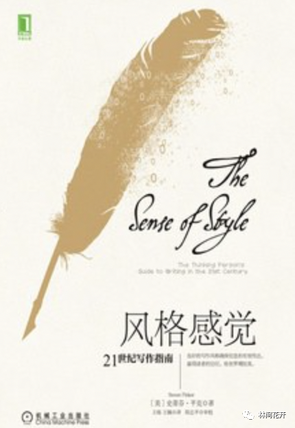
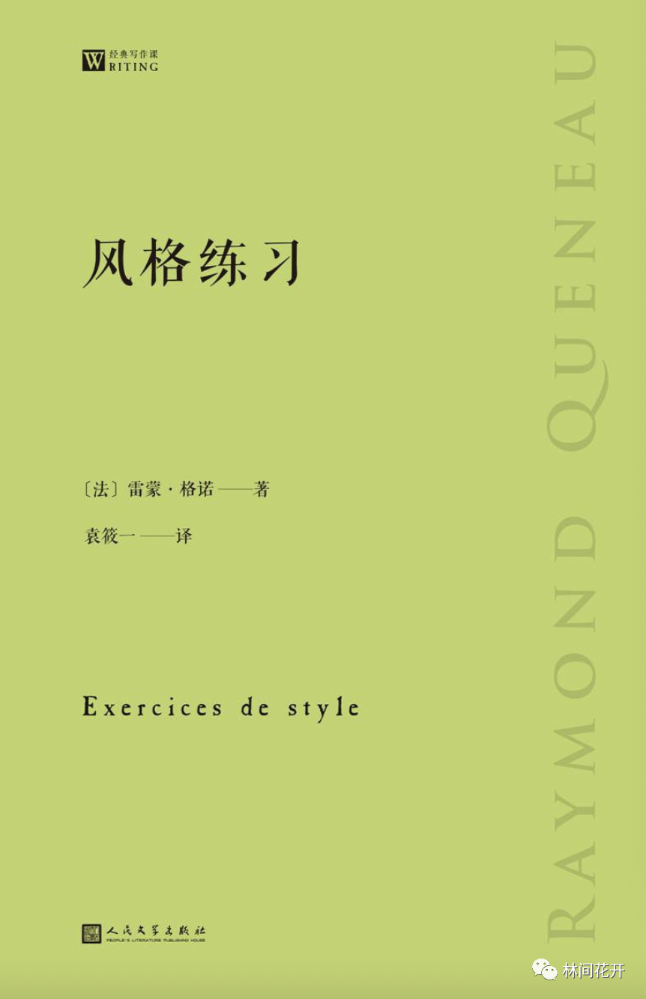

我们通常讨论写作时，会谈及其技巧，误以为只要熟练掌握词汇、语法和篇章结构，就能娴熟地写作。然而，这种观念其实是一种误导。

想一想，当我们回顾一个作家，我们记住的不仅仅是他们的写作技巧，更是他们独特的写作风格。比如张爱玲和余光中，他们都翻译过海明威的《老人与海》，同样的文本，翻译的风格却大相径庭，这归功于他们各自独特的写作风格。

张爱玲擅长用口语化、生动自然的流水句，细腻入微，营造出丰富的细节。余光中则精炼、言简意赅，善于使用三、四个字的词组。他们都以各自的方式，创作出中文的独特之美。

写作风格并不仅仅是伟大作家的特权，它更是每一位写作者在动笔之前都需要深思熟虑的基本立场。

所以写作新手首要学习的不是写作技巧，而是写作风格，如何习得？以下给你推荐四本跟写作风格有关的书目。

《古典风格》由弗朗西斯-诺尔.托马斯和马克.特纳合著。

书中提出一个颠覆性观点：写作是一项智力活动。这意味着写作和口头表达一样需要大脑在动笔之前整理思路，并且确信自己要写什么，以及如何写。这个过程其实是在塑造一种写作风格。托马斯和特纳归纳为「古典风格」，这是一种自然表达的写作风格，古典风格备受认知科学、神经科学、心理科学和文学领域的极度推崇。

如果写作技巧是写作的术，那么，写作风格就是写作的道。学习写作，不只追求写作技巧，如遣词造词、划分文章段落等，还要塑造出风格，不然光有写作技巧，没有写作态度，就如一个不善交谈的人，掌握了一堆谈话技巧，却沟通不顺畅，这样的文章注定失败。

什么是古典风格？认知科学家史蒂芬.平克推崇古典风格，在《风格感觉》一书中，引用一章介绍古典风格，并使用「观看世界」的隐喻解释：

> 观看世界是古典风格的主导隐喻。作者看到了读者没看到的东西，引导读者的视线，使读者自己发现它。写作的目的是呈现不偏不倚的事实。当语言与事实一致时，写作就算成功了；成功的证据就是清楚简洁的表达。

从观看世界隐喻中，你有两种体验：一种是展示你看到的世界；另一种则是与读者进行对话，这两点决定了古典风格如何表现，以及以何种方式表现，无论是具体的事物还是抽象的事物，都可以通过文字传达给读者，帮助读者理解文章中的含义，并让读者站在作者的角度来看待世界。整个过程，就如说话一样轻松、自然。

《风格感觉》这本书是史蒂芬.平克对怀特经典之作《风格的要素》的一次致敬，他受益于《风格的要素》，认同写作要朴实、简洁、清晰、真挚，但他又认为这本经典写作指南，有些过时，已不能满足于21世纪写作者：

> 斯特伦克和怀特书中的许多部分既有魅力又经得起时间考验，不过也有许多不尽如意的地方。在现代语言和认知科学出现之前，对写作风格的感觉已经养成，不能全听他的建议。

在他的作家妻子rebecca的鼓励下，才有了这本面向21世纪的写作指南——《风格感觉》。

如果只读一章，我推荐第五章连贯之弧，本书的重中之重。

一篇文章出现问题，有可能是行文臃肿、学术味过重，这类可以用古典风格破除；还有一类是晦涩难懂、高深莫测，这类是因为知识的诅咒引起，还有一些句子错综复杂、表述模糊不清，这些都可以画句子树来避免。还有一类是句子表达顺畅、简洁，单个句子看，没毛病，句也句串在一起，就支离破碎，让人无法理解前后意思，平克把这类问题通通称之为「不连贯」。

如何解决文章的不连贯？书中提到了「单一变量法则」，来自心理学的一个术语，在心理学实验中，我们尽量只改变一个因素，而保持其他的所有因素不变。这样，我们就能更清楚地看到这一个因素是不是真的对结果有影响。写作中，保持主语/谓语/宾语不变，调整句子中的其他字词。

《风格练习》是法国作家格诺在语言上的一次个人探索，他把语言当成了一种游戏。

他用99种方式，讲述了同一个故事：公共汽车上，有个年轻男子，衣着外貌有些乖张，与人发生争执，但很快就离开原地抢了个空座；之后不久，他又出现在圣拉萨尔火车站，与另一年轻人在一起，两人在讨论外套上衣扣的事情。

这本书很难归类，不是小说，不是杂文，书中既有笔记体、隐喻、反溯、主观视角、造词、否定、简单过去时、漫不经心、十四行诗、电报体等多种文体，可以说是99种不同风格的练习。

作者雷蒙.格诺不厌其烦探索不同的风格，练习了100多种，为了不让读者厌烦，他在书中只挑了99种，一个理想的数字。

他的灵感来自哪？据说是来源于一次演奏会，格诺听完巴赫的「赋格的艺术」，激发了他把音乐的变奏迁移到文学上：

> 用变奏的方式，围绕同一个单薄的主题衍生出几近无穷的变化，如此来写一部作品。 images/76968f2437b8.png

《风格的要素》是一本「英语写作圣经」，此书以简短的篇幅阐明了形成简明英语写作风格所必备的基本要素。

作者是威廉·斯特伦克的写作课讲义，他的学生E.B怀特把笔记变成书，这是一本最早谈论写作风格的经典之作。

斯特伦克教授认为，简洁即真理，好的英语写作应删繁就简、字字玑珠。书中的许多规则早已成为评判英文写作规范与否的基本准则。虽问世近百年，其参考价值丝毫未损。

虽然是一本经典的英语写作指南，但书中提到的写本基本原则“用名词和动词写作”、“使用肯定、明确、具体的词语”、“不要解释的太多”一样适合于中文写作，尤其是“删掉不需要的词”。毕竟写得简洁还是写作的第一要义。

### 小结

学习写作不仅仅是学习技巧，更多的是对风格的理解和应用。这四本书不仅仅是你写作的指南，它们也将引导你找到自己的写作风格，激发你无穷无尽的创作激情。