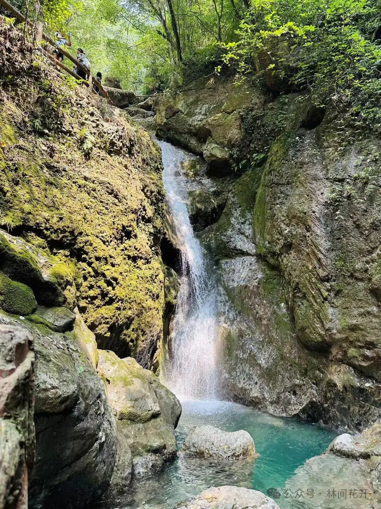

诗歌是什么？

不同的人，对诗歌有不同的诠释。对诗歌，我只可言会，不可言传，一种难以言传的体验，用最少的语言表达最复杂的情感，承载着我的喜怒哀乐，有诗意的时候，能体会流动的情绪。

来看看诗人们是怎么看诗歌的？

获得诺贝尔文学奖的波兰诗人维斯瓦娃·辛波斯卡曾以她一惯的谦逊回答：“不懂不懂”，但她却将诗当成了她的“救命稻草”，紧紧抓住，不曾放手。

在她眼中，万物皆可成诗：甲虫、石头、动植物、沙粒、天空，这些自然景物是诗；安眠药、履历表、衣服、电影、画作、剧场，这些平凡的生活元素也是诗；甚至梦境、仇恨、定时炸弹、恐怖分子等极端的情感和现实，都可以成为诗的素材。

在她的诗《写作的喜悦》中，她写道：“写作的喜悦，保存的力量，人类之手的复仇。”

对诗人余秀华来说，诗歌是她的拐杖：

> 面对诗歌是什么呢，我不知道，也说不出来，不过是情绪在跳跃，或沉潜。不过是当心灵发出呼唤的时候，它以赤子的姿势到来，不过是一个人摇摇晃晃地摇摇晃晃的人间走动的时候，它充当了一根拐杖。

庞德称诗歌为“猛烈的不加约束的表达”。

诗，是我们从观看到凝视的过程，是有限的生命对无限的拥抱。

诗，是人类用来对抗有限人生和缺憾现实的一大利器。

诗，是诗人摇撼世界时伸出的那条“新生手臂”。

诗，是诗人在梦想与现实之间，试图支撑起浮生的一根竿子。

我从小学习唐诗宋词，但真正与诗结缘，主动走进诗，读诗，写诗，是三年前接触到日本俳句大师小林一茶，短小、自由、灵动、意味深远的诗句，让我一下就爱上了俳句，有段时间，捧着他的诗句反复读，模仿着写诗。

> 露珠的世界，然而在露珠里——争吵

这是一种时空变形，人生如朝露，短暂而易碎，一茶将“争吵”置于露珠的世界中，读来既有张力，又意趣盎然。

有个朋友喜欢松尾芭蕉的诗，床头常年放着他的作品，睡前醒来都读一读。一年下来，她写了几百首短诗。受她启发，我也开始写短诗，少则几个字，多则几行，这种短小，自由，表达门槛极低的短诗，很适合我。从那以后，我尝试写现代诗和童诗，越来越体会到诗歌的独特魅力。

看到缓缓流动的河水，写下：

> 悠悠的河水

> 是我的枕头

> 在风抚摸下入睡

到了秋天，写下：

> 街道边

> 一把锈迹斑斑的耙子

> 放在

> 一堆落叶上

> 飞驰而过的电动车

> 把落叶吹得

> 仓皇而逃

> 停留在那张长椅下

> 诉说着一个古老的故事

> 秋天的气息

> 在徘徊——

走进诗，诗就成了我的新生手臂。在登山时，看到山谷，清泉击石，有了诗意：

> 好想把这里的阳光、清泉

> 林间跳跃的松鼠

> 还有蜘蛛网——浑然天成的艺术品

> 统统打包回家。

在连绵的雨天，我会想念跟小孩在植物园寻找春天的游戏，想念树叶、花朵、泥土，有了这首小诗：

> 我想要一个篮子

> 装下绿芽、树木

> 摘一朵路边的小野花

> 放进来

> 阳光、蓝天、白云也带上

> 我想要有个篮子

> 可以的话把春风也装进来

> 放一双舞鞋

> 跟着它的节奏跳踢踏舞

> 不要说我太贪心

> 我还想带春天回家

> 每天听它碎碎念

小孩是天生的诗人，和她们在一起，总能听到她们脱口而出的诗句。看着手里半片山楂片，再看月亮，自然说出「月亮在模仿我」；与单车后面的小朋友聊天，来回叫嚷着，听不清，她来了句「好想给他的耳朵装个天线，加强信号」；看到西边太阳洒满客厅，说了句「太阳不请而入，整个黄金屋」。

写了几十首短诗后，我对诗歌越来越有感觉，它是一种朦胧的美，是洒在窗台的月光，是缓缓流淌的清泉，是拂面而来的轻风，也是树叶轻吻泥土的声音。平常不过的日常，让我感觉到如此的真实，真切，如果没有诗歌，我不会去留意它，也不会去触摸它，更不会有内心的激荡。