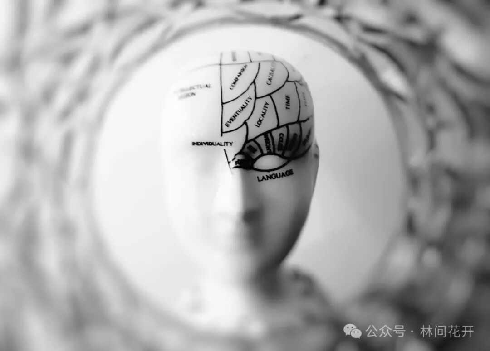
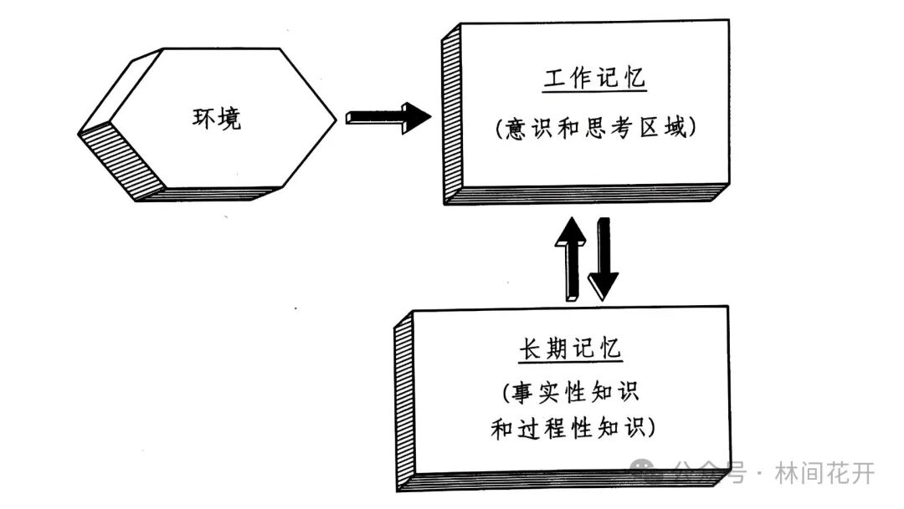

给侄女推荐了两本认知心理学在学习中的应用书籍，其中一本是《为什么学生不喜欢上学》。这是一本给我忽略的好书，吃灰多年，近期才开始阅读，读得意犹未尽。

作者是丹尼尔·T·威林厄姆（Daniel T. Willingham），一位认知科学家，也是弗吉尼亚大学心理学系的教授。他的研究重点是，把认知科学和神经科学的研究成果，应用到教育和学习中。

书的核心是探讨大脑如何存储和提取信息，这是认知心理学的核心内容。威林厄姆精选了9个关键的认知原理，每一条都基于大量实验研究，极具颠覆性。

## 大脑的思考过程

我从一张大脑模型图开始阅读，这张图帮助我更清晰地理解了大脑的思考过程。

思考的过程分为三个主要阶段：从环境刺激开始，进入工作记忆，最终存储到长期记忆。

- **环境**：指的是你从周围感知到的信息，如风景、声音、触觉等。环境也可以是待解决的问题。

- **工作记忆**：这是大脑的“临时工作台”，专门处理信息，就像便利贴一样，容量有限，只能同时保存少量信息。计算18*6的过程，动用的就是工作记忆。

- **长期记忆**：这是大脑的私人资料库，用于存储对世界的理解。包括两类知识：事实性知识（如5+5=10）和过程性知识（如骑自行车的技能）。

这张图中的箭头显示了信息的流动：工作记忆与长期记忆紧密相连。当我们思考时，工作记忆中的信息既可以来自环境，也可以来自长期记忆，当有人问起「你的初中老师如何时」，你的长期记忆给激活。

理解了大脑的思考模型的背景知识后，再看书中的九大认知原理，就游刃有余了。下面是其中三条印象最深刻的原理：

## 大脑不擅长思考

作者在第一章提出了一个极其反直觉的观点——大脑其实不擅长思考，它是认知上的吝啬鬼，能不思考则不思考。原因是思考非常费力，即使我们不主动思考，大脑依然在消耗能量。

> 人生来就有好奇心，但我们不是天生的杰出思想者；除非认知环境符合一定的要求，否则我们会尽可能地避免思考

为了节省资源，大脑倾向于让记忆代劳。

但人天然喜欢探索和解决问题，享受成功解决问题后的愉悦感，比如解决了一道难易适中的数学题后，乐得其中的感觉让你很爽。这种体验叫做心流，是美国心理学米哈里·契克森米哈赖提出的一个概念，描述人在做一件事时全然忘我，浑身不知，做成后身心满足的感觉，让大脑乐在其中做了它不擅长的思考。

为了激发大脑主动思考，挑选的问题，要符合「最近发展区」内——跳起来够得着。

结合大脑的思考模型，想要有效思考，离不开以下条件：

- 环境中的信息必须与当前任务相关；

- 工作记忆有容量限制，一次处理信息的数量不超过4；

- 长期记忆要有处理问题时所需的背景知识和技能。

启发：

1、利用大脑爱新鲜的特点，阅读不要只读一本书，而是对读多本书，建立主题阅读，满足大脑的猎奇心。

2、信息过载时，不妨分组记忆，压缩后的信息能节省存储空间，比如公式、模型，都是压缩过的信息。

## 用已知学未知

工作记忆处理信息时，会提取长期记忆中的知识，当你在某个领域积累足够的知识，在学习这个领域的新知识时更容易。有了7 * 8=56这个常识，你才能计算出17 * 8的结果。

如果不知道Ocean（海洋）的英语单词，我就不可能用一个词汇记住「大五人格」理论的五要素：外向性、神经质、开放性、尽责性、宜人性，五个英文首字母。

四年前刚接触认知心理学的教材，看到这段话很懵，每个字都认识，却理解不了意思：

> 斯奎尔的记忆分类图将记忆划分为陈述性和非陈述性记忆。陈述性记忆进一步细分为语义记忆和情景记忆，前者与事实性知识相关，后者则与事件和个人经历的记忆有关。而非陈述性记忆则涵盖了程序性技能、条件反射、启动效应和非联想性记忆（如习惯化和敏感化）。

> 在这一模型中，非陈述性记忆的表征方式更倾向于通过重复性学习或情境性的无意识反应来固化记忆痕迹，具有较低的可语言化程度。而启动效应的引入则说明，语义或知觉的激活可以在未察觉的情况下增强与该刺激相关的反应倾向，从而促进认知操作的高效化。这一分类体系也揭示了记忆在显性知识获取与隐性技能发展中的差异性和互补性机制。 images/03f2d1e7e2ae.jpg

时隔多年后，在读了一些认知心理学相关书籍并掌握了外显记忆和内隐记忆的概念后，再次阅读《认知心理学及其启示》，就能真正理解其中的内容了。

在《刻意练习》一书中提到，国际象棋专家与新手的区别不仅在于逻辑思考的能力，更在于他们的长期记忆中存储了大量的背景知识。

这种背景知识让专家能够快速识别和理解棋盘上的模式。换句话说，大师在看到一个真实棋局时，不是逐一记忆每个棋子的具体位置，而是将棋盘分解成一些熟悉的模式，如「防御阵型」或「攻击路线」。

这些模式通过多年练习和比赛被储存在长期记忆中，形成了丰富的背景知识，帮助他们快速作出判断和决策。

启发：

1、背景知识直接影响信息处理的效率，通过压缩信息和形成知识组块，有助于优化工作记忆的使用空间。因此，多积累某一领域的背景知识，可以用已知带动新知，形成“滚雪球”效应。在阅读较难的书籍前，建议先选择与认知水平相匹配的入门书籍，逐步过渡到更高难度的内容。

2、在教孩子时，尽量将问题分解成更细的步骤，让她先掌握基础技巧，再逐步提升。例如，在一年级学拼音时，先掌握好声母和韵母的基础知识，再逐渐学习两音节和三音节的拼读。

## 有效的练习

如果不借助任何工具，心算 19 × 8 的结果我们大多数人都能算出来，但要心算 184409 × 34554，就变得几乎不可能了。这是因为我们的大脑无法在工作记忆中存储如此复杂计算的中间步骤。

前面提到，大脑的工作记忆就像一个临时的工作台，用于思考和处理信息。由于工作记忆的容量有限，一次只能处理少量信息，而信息的来源既可能是环境，也可能是长期记忆。工作记忆的容量是人类认知的一个瓶颈，一旦信息超载，思考就会失败。我们无法“扩容”或“升级”大脑，唯一的解决方法就是通过**练习**来突破这个瓶颈。

练习带来的好处：

- 获得基本功

- 提高处理信息的能力

- 改善迁移知识的概念

简单的重复和题海战术，就会让练习过于机械、缺乏挑战，就陷入枯燥和无聊中，效果反而不好。

更好的练习策略，让技能的自动化达最大收益。自动化后腾出更多的工作记忆空间。

如何进行有效练习？

在《认知天性》一书中，整本书都在探讨如何科学地进行练习，提出了多种有效方法，如**测试效应**、**生成效应**、**分散学习**、**交错学习**等。这些方法都基于一个核心原则：**必要难度**。这个原则强调给大脑设置适当的困难，因为记忆的存储和提取是负相关的——存储得越轻松，提取反而越困难；相反，存入的过程越具有挑战性，提取就会更容易。

在实践中，我们可以应用这一原则进行学习和复习。例如：

- **阅读时**，不要边读边写笔记，而是在阅读完成后隔几小时再写，这样可以强化记忆效果。

- **复习时**，不要只读一次就结束，而是隔一段时间后重新阅读，温故而知新，巩固所学知识。

- **理解概念时**，不要死磕一个概念，而是尝试用其他相关概念或不同的书籍来攻克同一问题，从多个角度加深理解。

## 小结

大脑的思考过程，就是信息存储与提取的过程。理解了这一点，我们就能「取法其上，得乎其中」，更高效学习：专注当前的任务，控制信息量的输入，善用已有的背景知识，用科学的练习来巩固所学，博观而约取，厚积而薄发，用已知带动新知，形成更大的知识雪球。

注：图片来自pexels