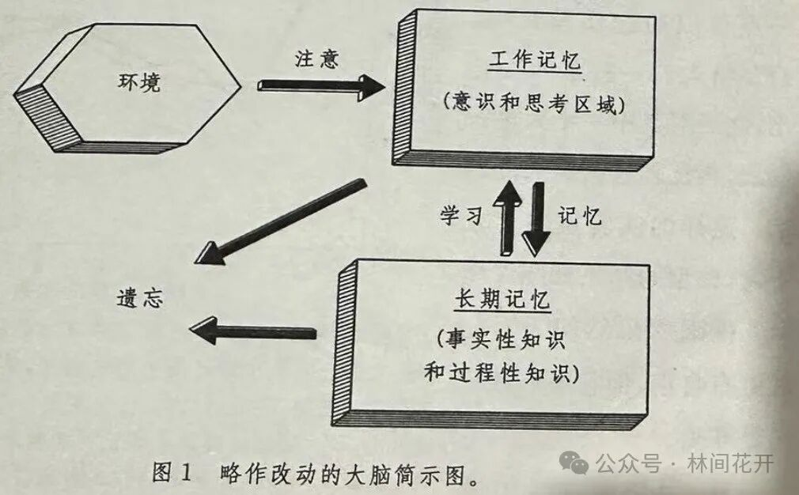

“得了灰指甲，一个传染俩......”

有段时间，娃对这个广告词念念有词，当成顺口溜，有事无事就念一念。

我问她：为什么我跟你说的事情，你总是忘，广告词你倒记得很溜？

她回：多简单呀，又有趣，好玩。

其实，这正是大脑的一种认知现象。《为什么学生不喜欢上学》就有这一条：为什么孩子能记住电视里的所有细节，却记不住我们教给他的知识？

作者指出关键：记忆是思考的残留物。只有那些给认真思考过的信息，才会给记住。

大脑是怎么记忆的？

还得从大脑的简单模型说起，如下图：

从这个模型可以看出，信息要给「记住」需要经过这几个步骤：来自环境的信息在感知记忆（视觉、听觉、触觉）停留，只有给注意到的才会进入到工作记忆中，这是大脑思考和处理信息的区域，容量有限，一次只能处理少量信息。接着，经过充分加工的信息存入长时记忆，成为我们「记得住」的内容。

「为什么记不住」，看大脑是如何忘事的：

- 每天从环境中接收到的大量信息，给大脑过滤过，只有少量的才会给注意到，比如此刻，我在码字，窗外的声音和景物不会让我停下思考，更谈不上要记住，也不会去思考昨天发生了什么事。

- 信息不只是来自环境，也有来自长时记忆，但有时无法提取，在写作时，体会更明显。

- 长时记忆中的信息不存在了，但给点提示，又能记起来，比如你记不得小时候的一些人，但回到你住过的地方，才能想起来。

- 你花了精力，在工作记忆停留了一会，死活进入不到长时记忆。

大脑是个过滤器，有意识选择记忆，记住这些，忘记那些。就如开头的例子，小孩对广告词感兴趣，觉得好玩有趣，主动记忆，一回生两回熟，重复念几次后就记住了，对妈妈的话，选择性遗忘，左耳进右耳出，所以下次要跟小孩说话时，尽可能引发她的思考，而不是强塞。

小孩能记住广告，记不住课堂的知识，跟信息加工的方式有关，有言语和图像两种，广告符合了这两种，有图片有文字，有些还会有声音，这种多感官的刺激，让大脑更能记得住。

即使是只有文字的情况下，也会有不同的加工方式，试看下面两组词汇：

第一组：每隔2秒钟读出一个单词，读完后，在30秒内默写单词。

第二组：与第一组的做法一样。

相比这下，第一组的单词更具体，直观，有画面感，可以用言语和图像来编码，而第二组的单词抽象，很难用图像来编码，记忆效果就不如第一组。

课程的知识也是偏抽象，数学的方程，物理的公式等，小孩很难把这些转换成画面、具象的理解，而且老师更多的是依赖语言输出，缺乏画面支持，小孩处理起来难度加大，记忆效果也会差很多。

在写作中运用具象化的方法同样十分有效。阳志平老师在“快写慢改”写作课中提到“意象写作法”：写作时先找到一两个生动、具体的词汇，如“星星”“大海”“沙漠”等，能让大脑快速热身，进入写作状态。

古诗词中有大量的意象词汇，很容易让人有画面感，比如读苏轼的《卜算子·黄州定慧院寓居作》：

> 缺月挂疏桐，漏断人初静。谁见幽人独往来，缥缈孤鸿影。惊起却回头，有恨无人省。拣尽寒枝不肯栖，寂寞沙洲冷。

诗中的“缺月、疏桐、幽、孤鸿、寒枝、沙洲等意象，瞬间让我跟千年前的苏轼产生共鸣。

读张爱玲的小说如看电视，经常有画面感的描写。比如在《等》中，她这样形容推拿医生庞松龄的样貌：

> 庞松龄生着阔大的黄狮子脸，粗颈项，头与颈项扎实地打成一片，不论是前面还是后面，看着都像个胖人的膝盖。

这样的描述能让读者看到一个鲜明的人物形象，跃然纸上，很深刻。

广告之所以能让人记住，是利用了多种感官刺激，符合大脑的多通道加工原理，这给我的启发是，给小孩传授知识时，可以多种形式，图片、视频等，使用文字时，尽可能用生动、有趣、有画面感的话语描述，把知识「讲成画面」或是「故事」，让小孩更好理解和记住。

*注：图片来自pexels*